<p align="center">
  
</p>

<h1 align="center">LogSeek Studio</h1>

<p align="center">
  <b>A native log and table explorer for Windows.</b><br>
  Open a CSV, JSON, Excel, EVTX or plain-text log of millions of rows, then search, filter,
  group and compare it while the window stays responsive. Free, offline, and your file is
  only ever read.
</p>

<p align="center">
  <a href="https://github.com/akhil-dara/LogSeek-Studio/releases/latest"></a>
  <a href="https://github.com/akhil-dara/LogSeek-Studio/releases"></a>
  <a href="https://github.com/akhil-dara/LogSeek-Studio/actions/workflows/ci.yml"></a>
  
  
  
  <a href="LICENSE"></a>
</p>

<p align="center">
  <a href="#download">Download</a> ·
  <a href="#screenshots">Screenshots</a> ·
  <a href="#features">Features</a> ·
  <a href="#measured">Measured</a> ·
  <a href="#first-five-minutes">First five minutes</a> ·
  <a href="docs/how-it-works.md">How it works</a> ·
  <a href="#build-from-source">Build from source</a> ·
  <a href="docs/README.md">Documentation</a>
</p>

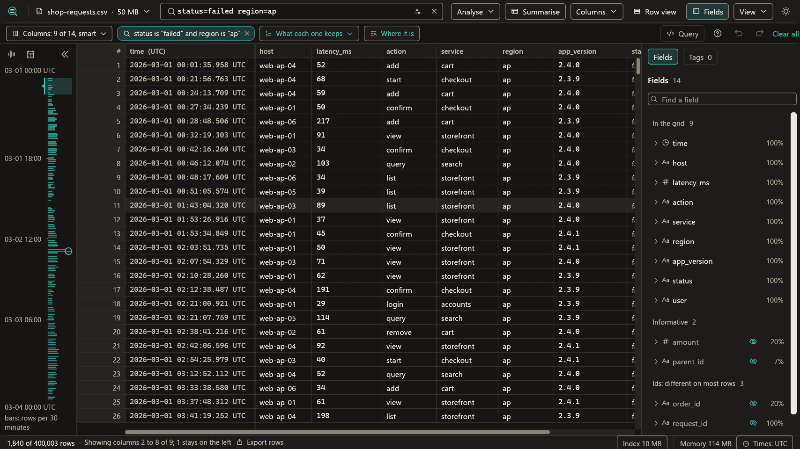

LogSeek Studio is a desktop app for people who have to **read big logs and exports**: web and
application logs, firewall and proxy exports, Windows event logs, audit trails, cloud exports,
spreadsheets somebody sent you. It builds an index beside your file once, and after that every
search, filter, count and chart is answered from the index.

It is meant for **incident response, forensics, operations and data clean-up work**, where
counts need to be exact and the evidence must not change. There is no server to set up, no
query language to learn first, and nothing leaves your machine.

## What it does

| | |
|---|---|
| **Your file is only read** | LogSeek never writes to the file you open. The index, your tags and the columns you make are kept apart from it, in a folder you can choose. |
| **Values are shown whole** | A long value wraps or scrolls rather than being cut, and lists page through all of their entries. |
| **Totals are exact** | Row counts, shares and group sizes are counted, never estimated or sampled. |
| **The window stays responsive** | Rows show while the file is still being indexed, and long work runs behind the window and can be interrupted. |
| **Time is a place** | A time spine beside the rows shows where the activity is. Click to jump, drag to keep a period, and see quiet gaps called out between rows. |
| **Search without learning a language** | Type a word. Or `status=failed region=ap`. Or build a search from menus and read back, in a sentence, what it finds. |
| **Analysis from your own data** | Unusual rows with the reason for each, what sets one group of rows apart, what is new in a period, patterns in free text, related rows followed as a tree. It works from the file in front of you, not from a built-in list. |
| **Memory that adjusts** | It uses more memory only while heavy work needs it and gives it back when the work stops. |
| **Says what it could not read** | Broken rows, unfinished records and unreadable parts are counted and stated above the rows. |
| **Offline by design** | No account, no cloud, no telemetry, no AI. The program never uses the network. |

---

## Download

Windows 10 / 11 (64-bit) programs are on the
[Releases page](https://github.com/akhil-dara/LogSeek-Studio/releases/latest). Nothing else
needs to be installed.

| File | Use it to |
|------|-----------|
| `LogSeek-Studio-<version>-setup.exe` | Install. It asks whether to install for you only (no administrator rights) or for all users, and adds a Start menu entry and an optional desktop icon. |
| `LogSeek-Studio-<version>-windows-x64.zip` | Run without installing: unzip anywhere (for example a USB drive) and start `logseek.exe`. It is one program file. |
| `SHA256SUMS.txt` | Check a download: `Get-FileHash <file> -Algorithm SHA256` in PowerShell. |

- Unattended install: `LogSeek-Studio-<version>-setup.exe /VERYSILENT /CURRENTUSER`
  (`/ALLUSERS` installs for all users and needs administrator rights).
- The programs are not code-signed yet, so Windows SmartScreen may ask for confirmation on the
  first start (**More info**, then **Run anyway**). You can also
  [build it yourself](#build-from-source).

---

## Screenshots

All screenshots show an invented demo file (requests to an online shop); no real data.

| | |
|---|---|
| 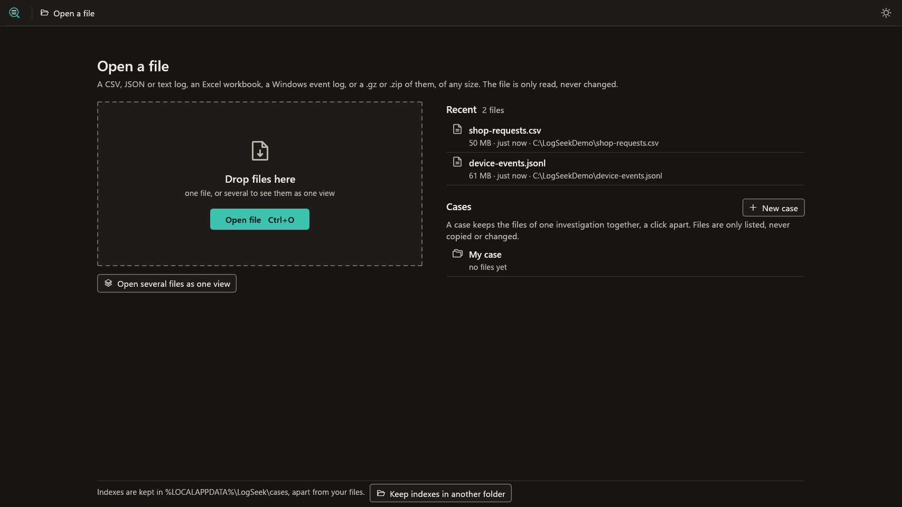 **Start**: drop a file, pick a recent one, or keep the files of one investigation together as a case. | 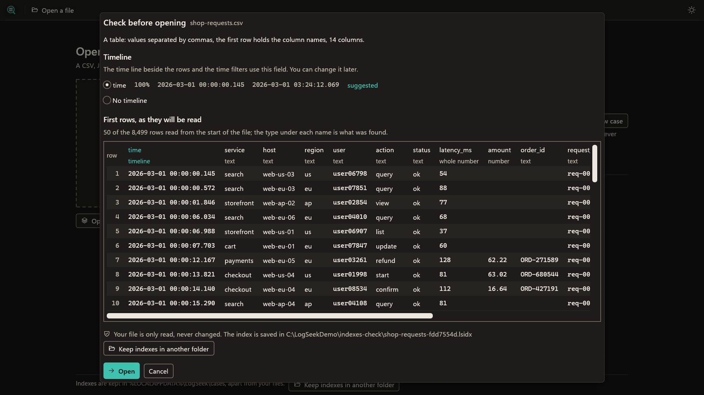 **Check before opening**: see how the file will be read and pick the timeline before anything is indexed. |
| 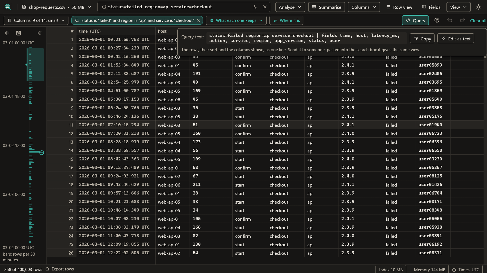 **Search and filter**: each filter is a chip that says what it means; the whole view is one line of text you can pass on. | 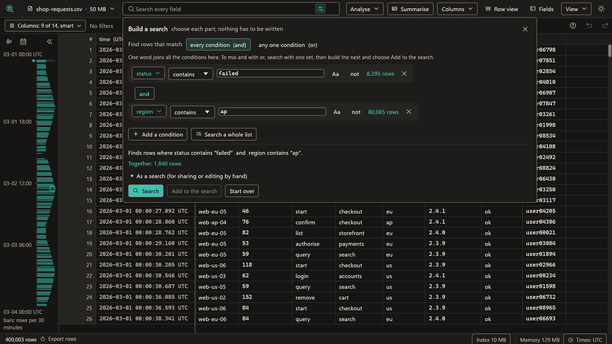 **Build a search** from menus, with the row count beside each condition and the result said in a sentence. |
| 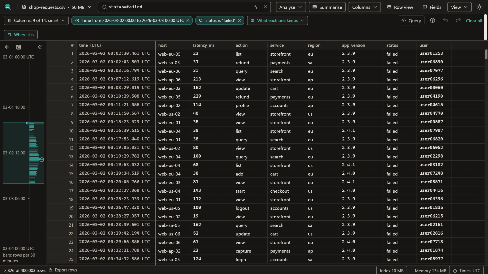 **Time spine**: keep a period by dragging on the rail; the chip above the rows names it. | 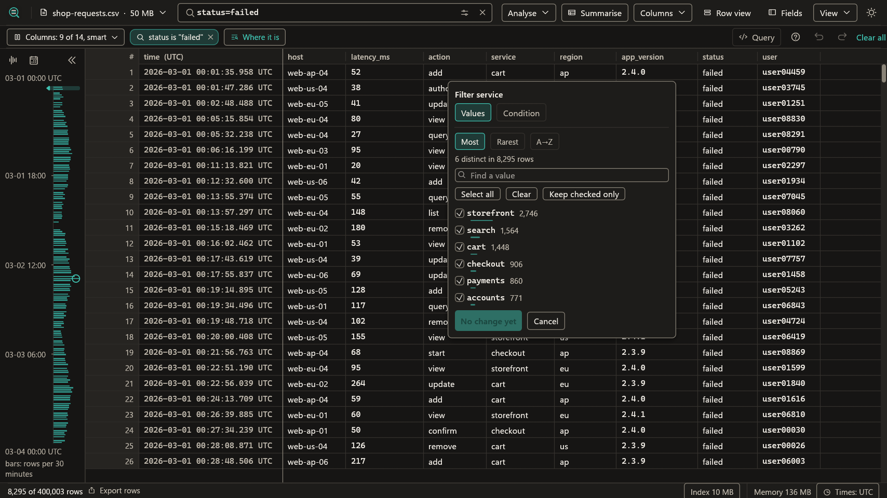 **Filter a column**: every value with its exact count; tick what to keep. |
| 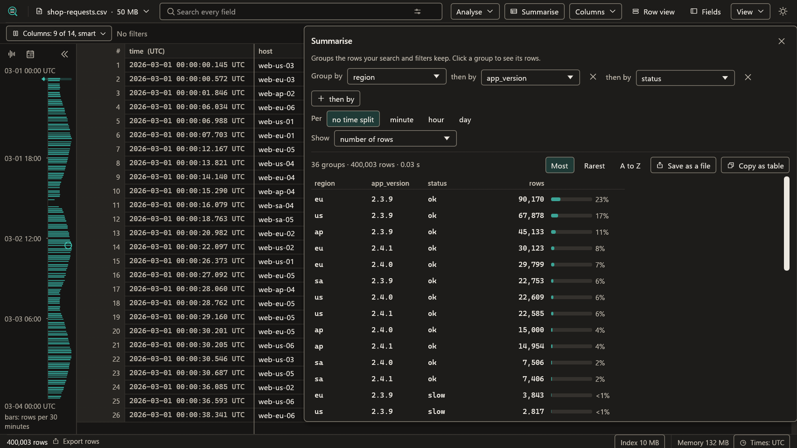 **Summarise** by as many columns as you like, optionally per minute, hour or day; copy it or save it as a file. | 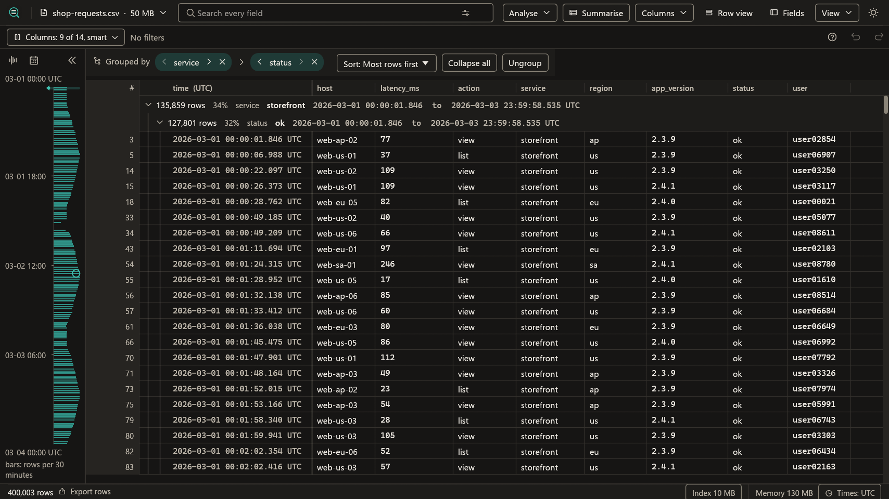 **Group rows** in place: each group with its count, share and time range. |
| 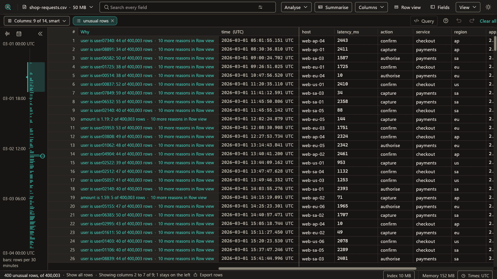 **Unusual rows**: the rarest rows first, each with the reasons it stands out. | 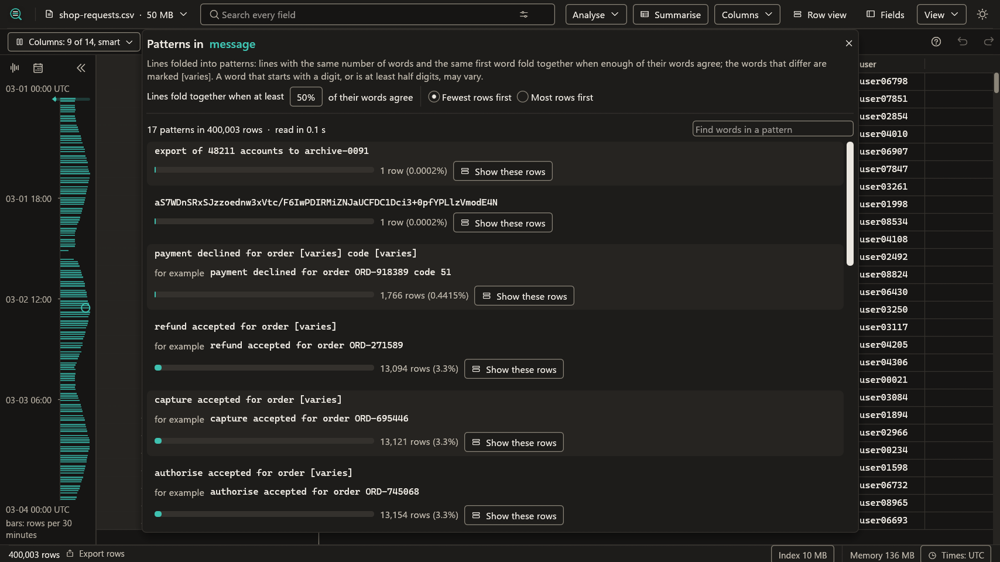 **Patterns**: free text folded into patterns, the words that vary marked, rarest first. |
| 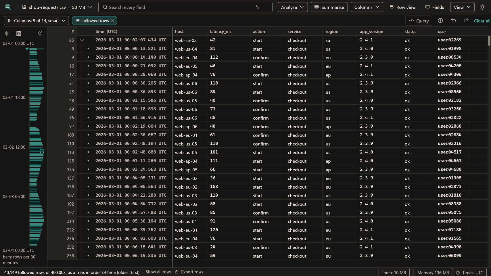 **Follow related rows**: from a row to the rows it links to, as a tree. | 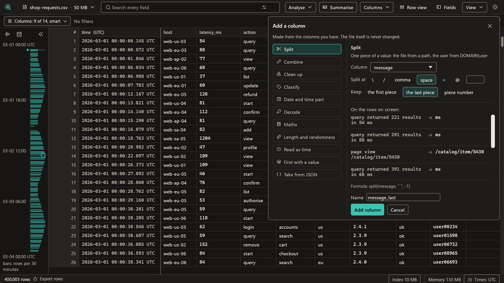 **Add a column** from cards (split, combine, decode, read as time, maths and more) and check the result on real rows before adding it. |
| 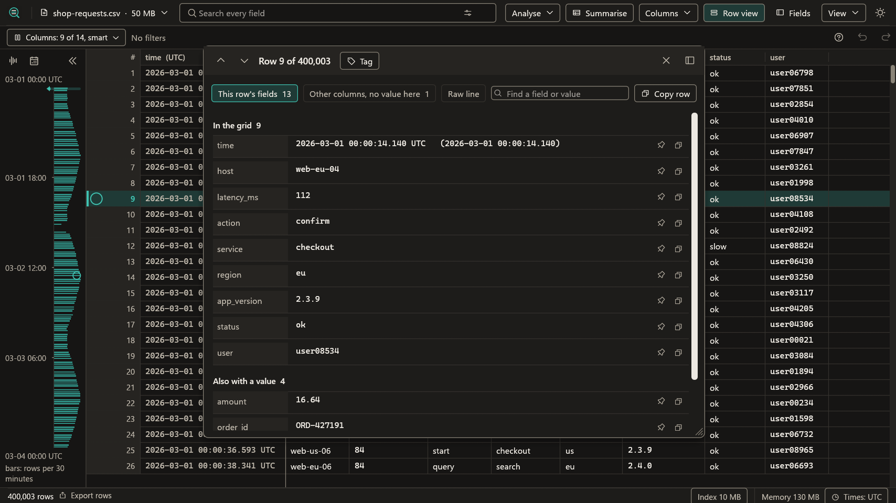 **Row view**: one row as a table of every field, with the raw line a click away. | 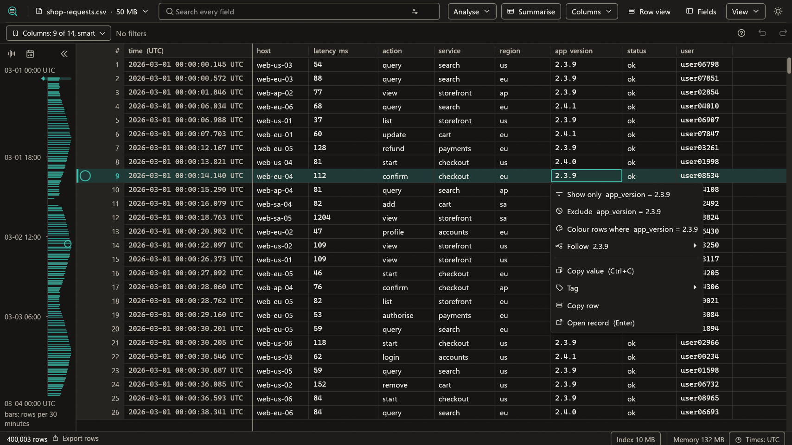 **Cell menu**: show only, exclude, colour, copy or tag from any cell, by mouse or keyboard. |
| 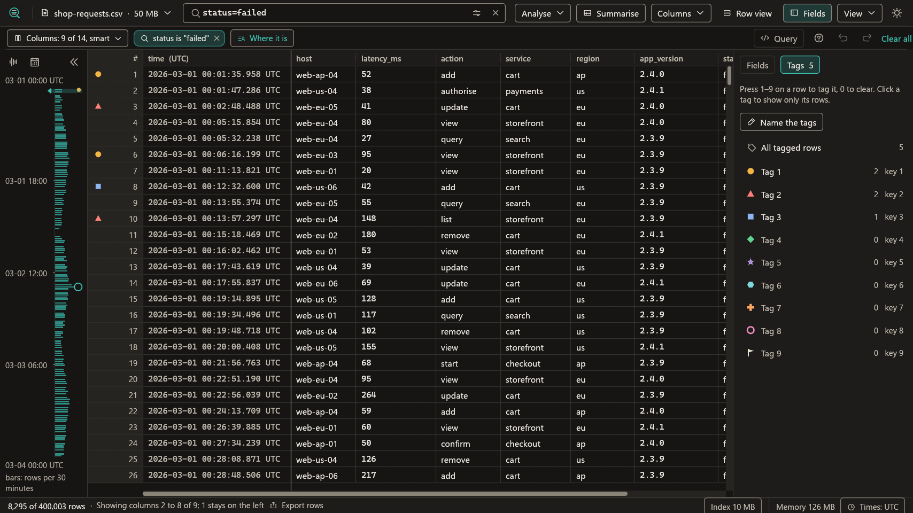 **Tags**: mark rows with keys `1` to `9`, name the tags, and show only tagged rows. | 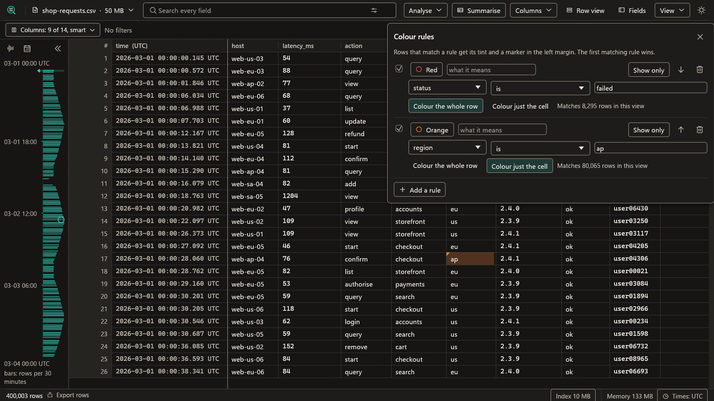 **Colour rules**: tint a whole row or just the cell when a rule matches. |

---

## Features

### Opens what you are given

- **Tables and text**: CSV, TSV and other delimited files, and plain-text logs, including logs
  with no header row.
- **JSON**: one record per line, JSON arrays, records inside a wrapper key, and pretty-printed
  JSON. Nested fields become columns named like `a.b.c`. A file that is one object holding
  several lists opens part by part, each list as its own tab.
- **Workbooks**: `.xlsx`, `.xlsm`, `.xlsb`, `.xls` and `.ods`.
- **Windows event logs**: `.evtx`.
- **Packed files**: `.gz` and `.zip`. Open one file from a zip and the others stay a click away.
- **Several files as one view**: one set of rows, each row saying which file it came from.
- **Cases**: keep the files of one investigation together; files are only listed, never copied.

### Search and filter

- Plain words, `column=value` terms, comparisons, value lists and time ranges, joined with
  `and`, `or` and `not`.
- Every filter becomes a chip above the rows that says in words what it does; switch a chip
  off, invert it or remove it.
- **Build a search** from menus when you would rather not type, and **Search a whole list** of
  keywords from a file in one pass.
- What you searched for is marked in the rows. **Where it is** lists the cells that hold each
  part of the search, by column, and **What each one keeps** counts every condition on its own.
- **Find** in the rows shown, and **Search every cell** when you do not know the column.
- Saved searches, a query workspace for longer work, and undo and redo for every change of view.

### Time

- A **time spine** beside the rows: bars for activity, click to jump, drag to keep a period.
- A **calendar** to pick days and hours, and a date and time picker for time conditions.
- **Quiet gaps** marked between rows, so a silence in the log is something you see.
- Times shown in UTC or local time, with the column you chose as the timeline.

### Columns and formulas

- A **smart view** that starts with the columns that say the most, and a chooser for the rest.
- Pin, wrap, fit, sort and reorder columns; group by any of them.
- **Add a column** without touching the file: split, combine, clean up, classify, take a date
  or time part, decode, do maths, measure length and randomness, read a value as a time,
  take a field out of JSON text.
- A formula language with functions for text, numbers, time, JSON and decoding, checked live
  on the rows on screen. See [Columns and formulas](docs/columns-and-formulas.md).

### Analysis

- **Summarise**: counts and measures by any number of columns, with a time split.
- **Unusual rows**, with the reasons.
- **What sets these rows apart** from the rest, and **what is new** in a period.
- **Timeline signals**: changes of rate and rhythm over time.
- **Patterns**, **shapes** and **strange text** in a column; **rare pairs** between columns.
- **Follow related rows** through the columns that link them.

All of it is worked out from the file in front of you. See [Analysis](docs/analysis.md).

### Evidence and export

- **Tags** `1` to `9` with names, kept with the index and shown on the time spine.
- **Colour rules** for rows and cells.
- **Export rows** as CSV, JSON lines or an Excel workbook, with the columns you choose. Values
  a spreadsheet would run as a formula are marked as text.
- **Copy** a cell, a block of cells, whole rows, or a summary as a table.
- **Pass a view on as one line**: paste it into the search box and the same view comes back.

### Keyboard and screen

- Everything has a key: `/` to search, `Ctrl+K` for any command or column, `Space` for the row
  view, `?` for the full list. See [Keyboard](docs/keyboard.md).
- Dark and light themes, both checked for contrast. Works from 1366 x 768 up and scales to
  large screens; text size and layout are yours to change.

---

## Measured

One run on a laptop with a 6 GB CSV of 48 million rows. Your numbers will differ with the
machine and the file.

| | |
|---|---|
| First open (building the index) | 79 seconds; rows are on screen while it runs |
| Opening the same file again | 0.5 seconds |
| A search across all 48 million rows | about 0.4 seconds |
| Index size | about a fifth of the file |
| Memory, file open and idle | about 150 MB |
| Memory while working hardest | about 1.1 GB, back to idle level about 20 seconds after |
| Frames that froze the window (over 100 ms) | none |

---

## First five minutes

1. Start LogSeek Studio and press `Ctrl+O`, or drop a file on the window.
2. On the **Check before opening** sheet, read how the file will be read, pick the timeline
   (or **No timeline**) and look at the first rows. Press `Enter`.
3. Click in the search box (or press `/`) and type a word. Rows that contain it stay. Press
   `Esc` to leave the box.
4. Press `Space` to see one row as a table. Press `1` to `9` to tag a row.
5. Press `Ctrl+K` and type what you want to do, or a column name. Press `?` for the list of keys.

---

## Security

Log files and exports often come from machines you do not trust, so every file is treated as
if someone had crafted it.

- The file you open is **never written to**.
- Readers have limits on nesting, sizes and disk use, and a part that cannot be read is skipped
  and counted, not allowed to stop the import.
- A list of files that arrives with other files may only name files in its own folder.
- Exports and copies mark formula-like values as text, so a spreadsheet does not run them.
- A fault inside one request is contained and reported; the app carries on.
- The program never uses the network: nothing is uploaded, checked or fetched.

---

## Build from source

You need Windows 10 or 11 and the stable Rust toolchain.

```
cargo build --release -p logseek
```

The program is built to `target\release\logseek.exe`: one file that needs nothing beside it.

[Building it yourself](docs/building.md) has every step: what to install, the tests, the
installer and the checksums. Releases are built by GitHub Actions
(`.github/workflows/release.yml`) when a version tag such as `v0.1.0` is pushed.

## Documentation

| Page | What it covers |
| --- | --- |
| [Getting started](docs/getting-started.md) | Opening files, the Check sheet, cases, where indexes are kept |
| [The workspace](docs/the-workspace.md) | The screen, the grid, columns, tags, colour rules |
| [Searching and filtering](docs/searching-and-filtering.md) | The search box, filters, time, saved searches |
| [Columns and formulas](docs/columns-and-formulas.md) | Columns you make, and every function they use |
| [Analysis](docs/analysis.md) | Summarise, group, unusual rows, comparisons, patterns, follow, list search |
| [Export and sharing](docs/export-and-sharing.md) | Export, copy, tags |
| [Keyboard](docs/keyboard.md) | Every key |
| [How it works](docs/how-it-works.md) | The engine, the index and how a search is answered, with diagrams |
| [Building it yourself](docs/building.md) | From source to program and installer |

## Contributing

Bug reports and ideas are welcome in
[Issues](https://github.com/akhil-dara/LogSeek-Studio/issues). When a file is read wrongly, a
few invented lines that show the problem help far more than a description. Please do not
attach real evidence.

## Licence

LogSeek Studio is free software. You can redistribute it and change it under the terms of the
GNU Affero General Public License, version 3 or (at your option) any later version, as
published by the Free Software Foundation.

It is distributed in the hope that it will be useful, but without any warranty. See
[LICENSE](LICENSE) for the full text.

The libraries LogSeek Studio is built on, and their licences, are listed in
[THIRD-PARTY-NOTICES.md](THIRD-PARTY-NOTICES.md).
