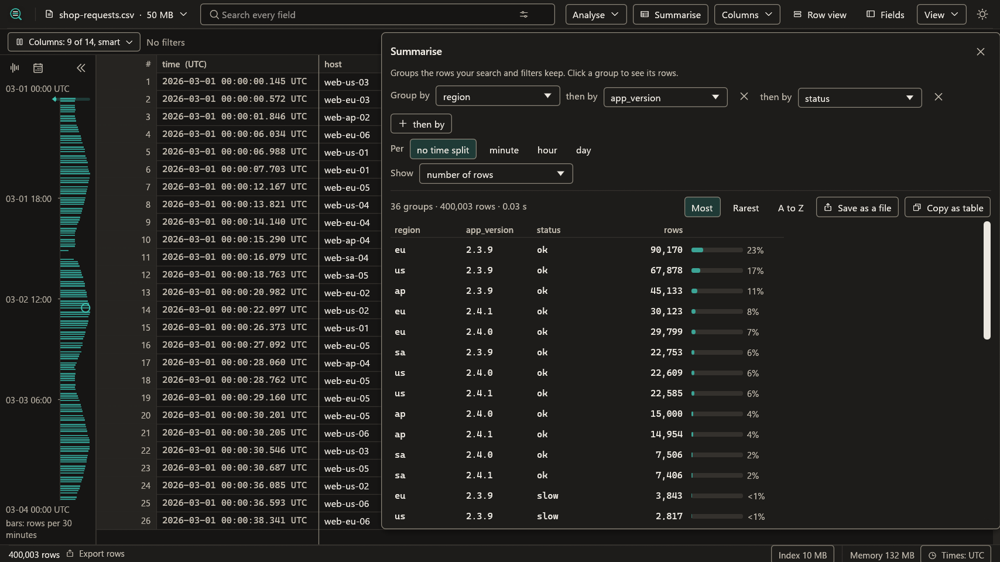
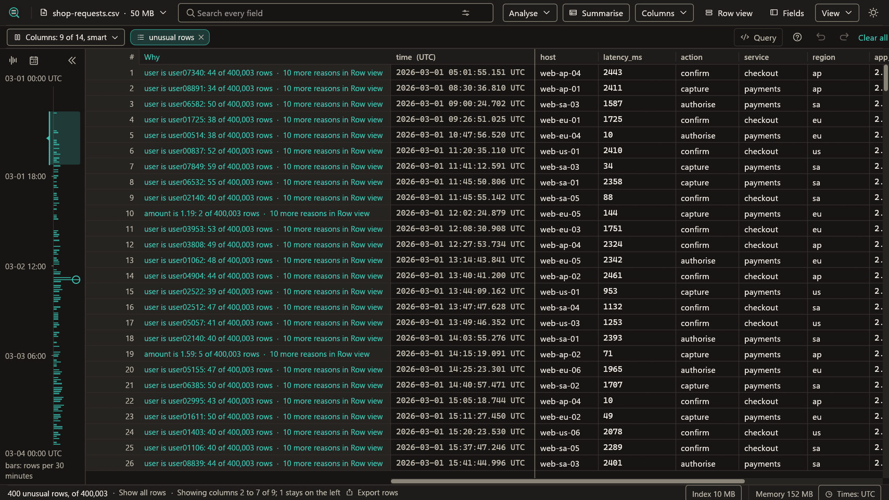
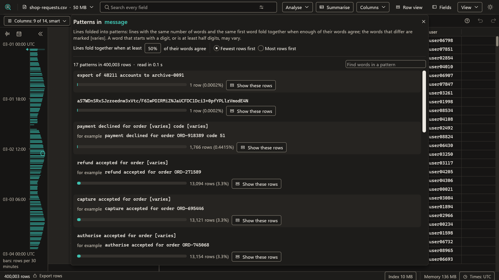
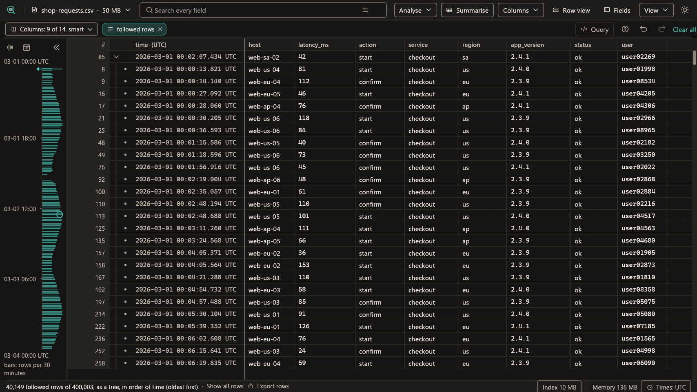

# Analysis

This page covers the tools that answer a question about your rows instead of just showing them: counting and grouping, finding odd rows, comparing a period with what came before, reading the text of one column, following links between rows, and searching for a whole list of keywords. For each tool the page says what question it answers, how to start it, how to read the result, and what it costs on a big file where a measurement exists.

Every tool here works on the rows currently shown, so a search, a filter or a kept period narrows what it looks at. Every tool learns from your file's own values. None of them uses a list of known names, products or patterns. Results are counted exactly and are never cut off.

Most tools start from the **Analyse** menu in the top bar. A few start from a column: right-click the column name. You can also press `Ctrl+K` and type the name of the tool.

The timings below were measured on large exports of 600 thousand to 800 thousand rows and 800 or more columns, on one machine. Your time depends on your file, your search and your machine.

## Summarise

**The question:** how many rows are there for each value of a column, or each pair of columns, and what are their totals or averages?

To start: press **Summarise** in the top bar.

To set it up:

1. Under **Group by**, pick a column. Press **then by** to add another level, as many as you like; the cross beside a level removes it.
2. If the file has a timeline, **Per** offers "no time split", "minute", "hour" or "day". Time groups are in UTC and the column is headed "time (UTC)".
3. Under **Show**, choose what to work out: "number of rows", "number of different values of", "total of", "average of", "smallest" or "largest". For all but the first, pick the column to use. Times are read as times.

The table fills in as soon as you change a choice. While it counts you see **Counting** and a **Cancel** button.

To read the result: the first line says how many groups, how many rows and how long it took, for example "4,210 groups - 603,813 rows - 0.31 s". Each row of the table is one group with its count. Every group is kept. There is no "all other values" line. Change the order with **A to Z**, **Rarest** and **Most**. **By value** also appears when you are not counting rows. All orders are over every group, and you read them by page.

Click a group to see its rows. That adds a filter for exactly that group. A group with no value is named **(no value)**. Rows where a made column could not be worked out form a group named **(could not be worked out)**.

**Copy as table** writes every group, tab-separated, ready for a spreadsheet. It writes all groups, not only the page you see.

**Save as a file** writes every group to a CSV or tab-separated file you choose.

Limit to know: if the number of different values is very large, the sheet can reach the memory limit while counting different values. It then says "The memory limit was reached while counting different values: the counts shown are at least these."

## Group rows

**The question:** what do the rows look like when folded into one line per value, with counts and times?

To start, either:

- Right-click a column name and choose **Group rows by this column**.
- Drag a column name over the grid. A place appears above the grid that reads "Drop here to group the rows by" and the column name. If a grouping is already on, drag onto the group line to add the column as the next level.

To read it: the **Grouped by** line shows one chip per level. On each chip:

- The left arrow ("Group by this one first") and right arrow ("Group by this one later") change the order.
- The cross ("Stop grouping by this column") removes the level.
- You can also drag a chip by its name to a new place. A mark shows where it will land.

The sort menu on the line offers: most rows first, fewest rows first (for rare activity), first seen, last seen, and A to Z. **Collapse all** closes every group. **Ungroup** removes the grouping.

Each group header shows its rows and their share of all rows, then the value in full, then the first and last time. A group opens on demand and scrolls through all its rows, with no limit. When you group by more than one column, each header also names its column. The headers of the open group stay at the top while you read its rows.

Keys: `Right` opens a group. `Left` closes it or goes to its parent. `Enter` opens a group or a row. A grouping stays with its tab.

Not done yet: grouping by a made column is not available. Right-clicking a cell inside a grouped row does not act yet.

## Unusual rows

**The question:** which rows are rare, and why?

To start: **Analyse** menu, **Unusual rows**.

How it scores: every row shown is scored by how rare its values are in their own columns. Your file is the measure. A value few rows share scores high. A number far out in its column scores high. An empty cell where other rows have a value scores high. A column weighs less the more of its values are all different. A column that names every row, or counts up row by row, weighs nothing. The timeline column is not weighed.

To read the result:

- The sheet says "A usual row scores N (half the rows score less)" and how many columns were weighed.
- A line lists the columns not weighed, and why.
- A bar chart shows how all rows spread across scores. A vertical line marks the cut. Click a bar to move the line there.
- **Rows scoring at least** holds the score. Edit it to move the line. The sheet then says how many rows are at or above it. The default line leaves about the most unusual thousandth of rows above it.
- **Unusual for** has two choices: **any reason**, or **their numbers together**. The second looks only for numbers that are each ordinary but rare as a group, such as a high load with a low temperature. Rows at the far end of what every row follows do not count.

Press **Show these rows** to put them in the grid. A **Why** band appears beside the row numbers. For each row on screen it gives the main reason, for example "user is carol: 1 of 20,000 rows", and "N more reasons". Hover over it for every reason. Columns empty in the same few rows are given as one reason. The band is worked out only for rows on screen, so it costs the same on any file size.

While it runs the sheet shows a **Stop** button.

Cost, measured on a 603,813-row, 831-column export: 20 seconds, with 599 rows above the line. For numbers together only, 9.5 seconds, reading 13 columns together.

## What sets these rows apart

**The question:** what is far more common in these rows than in the rest?

To start: show only some of the file (a search, a kept period, tagged rows). Then **Analyse** menu, **What sets these rows apart?**. Press **Compare**.

To set it up, choose what to compare the rows shown with:

- every other row of the file;
- the same search at other times;
- the same search before this period;
- the same search just before it (the same length).

The last three need a kept period on the timeline. To keep one, drag down the time spine.

Then set how strong a difference has to be: **In at least** a share of these rows (5% by default), and at least a number of times more common in them (2 by default). Both are yours to change.

To read the result: each line states a value or a pair of values in words with exact counts on both sides, for example "app is v2 and region is ap - 2,700 of these 3,000 rows (90%) - 460 of the 23,000 other rows (2.0%) - 45 times more common here". Two bars compare the shares. The strongest comes first.

- **Show only these rows** keeps the rows that match the line.
- **Leave these out** removes them.
- Conditions that hold in exactly the same rows are said once, and the others are named under it.
- Pairs that share one condition with identical counts are one line, with the other partners listed as able to stand in.
- A pair appears only when it says clearly more than either value alone.
- A column whose values all differ, or that has one value everywhere, never stands out.
- **Copy as table** writes every line.

If nothing qualifies, the sheet says so and gives the two thresholds it used.

Cost: the work is spread over every core of the machine, as far as memory allows. Measured on a 2.55 GB, 831-column export (197 thousand rows against 407 thousand): about 45 seconds.

## What's new in this period

**The question:** what appears in this period that never appeared before it?

To start: keep a period on the timeline first (drag down the time spine, or double-click a stretch). Then **Analyse** menu, **What's new in this period?**. If no period is kept, the app asks you to keep one: "Keep a period first (drag down the time spine), then ask what is new in it."

To read the result: the first tab lists, for each column, the values seen in the period and never before it, counted exactly however rare, each with **Show only these rows**. A line reads like "category - 3 values never seen before, in 24 of 72,421 rows here - before: 6 different values in 300,120 rows".

Columns come in an order the file decides: the columns that had the fewest different values before come first. A new value in a column that is usually the same is more striking than a new id. A column never filled before comes first of all.

The second tab, **More common than before**, is the same list that What sets these rows apart gives.

If nothing is new, the sheet says "Nothing in these N rows is new: every value of every column was seen in the N rows before."

Cost: on an 832-column export, the last day against everything before it took 11 seconds. On event logs and application-usage tables it took under a second.

## Timeline signals

**The question:** when was the file quiet, when did the rate of rows change, and which values come like clockwork?

To start: **Analyse** menu, **Timeline signals**. Or press the waveform button at the top of the time spine. The file needs a time column. The tool reads the times of the rows shown.

The sheet has three parts.

**Silent gaps.** Stretches with no rows that are far longer than the usual pause. A gap is at least ten times the usual pause and well past how much pauses usually vary. The longest comes first, with the exact last row before and first row after. **Show the minutes either side** puts that stretch in the grid.

**Steps in the rate.** Lasting changes of at least twice or half the rate of rows. They are found by splitting the timeline where the rate shifts most, and again within each part, with the silences left out. A line reads like "The rate went up 2.9 times at 11:00, from 2.2 to 6.5 rows a second". **Show the hour either side** puts the surrounding hour in the grid.

**Regular repeats.** Pick a column under **Each value of**. For each value, the sheet takes its rows in time order and looks at the gaps between them. The most alike gaps come first, for example "every 15 m 1 s, give or take 0 s - 647 rows". It uses the middle of the gaps, so a missed beat or some jitter does not hide a steady rhythm.

Cost: measured on a 603,813-row export, gaps and steps took 1.8 seconds, and one column's rhythms took 0.1 seconds.

Gaps in the grid itself are marked separately. Where the time between two rows on screen is far longer than usual, a thin band says how long it was quiet. This happens only when the rows run in time order. See [The workspace](the-workspace.md).

## Patterns in this column

**The question:** what do the lines of free text look like when the parts that vary are folded away?

To start: right-click a column name and choose **Patterns in this column**.

How it works: words are what lies between spaces. Lines with the same number of words and the same first word are folded together when enough of their words are the same. The parts that differ are marked `[varies]`, as in `tool.exe /get [varies] /r`. A word that starts with a digit, or is at least half digits, may vary. Nothing is assumed about what the words mean.

To set it up: the sheet says "Lines fold together when at least N% of their words agree". The default is 50. Choose **Fewest rows first** (the default, so the odd ones are on top) or **Most rows first**.

To read the result: each pattern shows an example and its row count. Every row belongs to the most specific pattern that fits it, so the count shown is exactly the rows you get. **Show these rows** puts them in the grid. There is no limit on the number of patterns. The same file gives the same answer every time.

Cost: measured on a 603,813-row column of command lines, 1,205 patterns in 0.6 seconds.

## Shapes in this column

**The question:** what shapes do the values have, and which shapes are odd?

To start: right-click a column name and choose **Shapes in this column**.

How it works: each value is read as runs of digits, letters and spaces, with the marks between kept as they are. For example: digits, ".", digits, ".", digits, ".", digits. The shapes come from the values themselves.

To set it up: choose how exact a shape is. The three choices are "any lengths", "the same lengths" and "letters and digits alike". They are the same choices as "is shaped like" in Build a search. Choose **Fewest rows first** (the default) or **Most rows first**.

To read the result: each shape has an example, its rows and a share bar. Empty cells are on a line of their own. With the rare ones first, an address where a postal code belongs, a broken line or a value cut short stands out. **Show only these rows** and **Leave these out** add the shape to the search. The count shown is the count you get.

## Strange text in this column

**The question:** which values are written unlike the rest of the column?

To start: right-click a column name and choose **Strange text in this column**.

How it works: the column is its own measure. One read learns which characters usually follow which in the column's values. Each value is then scored by how unusual its character pairs are, in bits per pair. This finds encoded or packed text, garbled characters, broken lines and disguised commands without a list of what they look like.

To read the result: the sheet says "Usual text in this column: N bits per character pair (half its rows score less)" and how many rows were scored. A bar chart shows how all rows spread, with a line marked. Click a bar to move the line, or edit **Show values at or above** N bits per pair. Every value at or above the line is listed, strangest first, with "stranger than N% of the column's rows" and its row count.

- **Show these rows** shows exactly those rows.
- **Show only this value** adds one value to the search.
- **Leave it out** removes it.

## Rare pairs with this column

**The question:** which pairs of values between two columns break the usual habit?

To start: right-click a column name and choose **Rare pairs with this column**. That column is A. Then pick the second column, B, using the find box in the sheet.

To read the result: every pair of values is counted exactly, a page at a time. There are two lists.

**Rarely seen with a common value.** A value of B seen with a value of A that is otherwise common. Pairs are ranked by how rare the pair is beyond the variety A already has. A value with two partners that breaks its habit comes before one with a new partner every time. A value of A that is empty has no habits and is left out. A line reads like "worker.exe with cleanup.exe: 1 row - 1 in 16,230 of the rows where parent is worker.exe".

**Seen with the fewest.** Values of B that only one or two values of A ever have, however many rows they have. A line reads like "seen with 1 of 143 values of parent - 3,381 rows".

Each line can be shown or left out.

Cost: measured on one pair of columns of a 603,813-row export, 24,840 pairs in 0.1 seconds.

## Follow related rows

The quickest way in is from a cell: right-click a cell (or press `Shift+F10` on it) and open **Follow** with its value. The menu lists the columns that hold that column's values, worked out from the file itself: for each, **Rows whose (column) is this value**, and **The whole tree from this row** through the strongest link. One click runs it and shows the result; the chip above the rows says what was followed, and **Change what is followed** in the status bar opens the Follow sheet on it. **More choices** opens the sheet directly, for other columns, a time limit, or following from many rows at once.

The followed rows are shown as a tree. Under each row, the rows that link to it are listed in the order the rows are sorted by (oldest first when they are not sorted and the file has a timeline), so a branch reads in the order things happened; sorting by another column puts the tree in that order. When the rows are not sorted, the tree uses the first column on screen that is shown as a time. The status bar always says which column the tree is in order of. Follow starts from the row you have selected, when there is one, and says the link for that row with its own value.

**The question:** which other rows link to these rows?

To start: **Analyse** menu, **Follow related rows**. Read the sheet from the top.

1. **Start from.** Choose the rows to start with: the rows with a tag, the selected row, or every row shown now. The sheet starts from your tagged rows if you have any, else the selected row, else the whole result.
2. **Find rows where** a column equals their another column. For example: rows where `parent_id` equals their `id`. When a link can be found, the sheet suggests one from the values: it looks at values, never at column names, and measures over the first million rows. You can change either column. A second column can be added when two columns can hold the same value. **Swap** walks the other way.
3. **When.** "at any time", or a time limit after the row, before it, or on either side, with a number and a unit. A time limit needs a timeline.
4. Tick **Keep following from what is found** to build the whole tree.
5. Press **Follow**.

To read the result: the sheet lists each step, such as "Step 1: 12 rows". Press **Show these rows** to see the starting rows and everything found in the grid. This replaces your search and filters; Undo brings them back. The result is a tree in the grid. Each starting row has the rows that link to it indented beneath, every level foldable, and rows keep the file's own numbers. `Alt+Left` and `Alt+Right` fold and unfold. Or press **Tag them** to tag everything found.

The rows a Follow shows are a filter like any other. Its chip in the filter strip has a cross, and **Clear all** shows the whole file again.

To save a link: type a name under **Name to save it as** and save it. It is offered on any file that has those two columns.

Cost: on very large files each step is one full pass over the file. Measured on a 673-column export, finding the suggested link took 0.6 seconds.

Not done yet: Follow does not work across files, on two column pairs at once, or by a made column. Tag marks and colour rules do not appear inside the tree. Selecting and copying rows does not work inside the tree.

## Search a whole list

**The question:** which of my many keywords are in the data, and where?

To start: **Analyse** menu, **Search a whole list of keywords**. Or choose **Search a whole list** at the bottom of Build a search.

To set it up:

1. Paste keywords in the box, one per line. Anything goes: addresses, hashes, names.
2. Or press **Load from a file**. A text file has one keyword per line. For a CSV or TSV you choose which column holds the keywords. Then press **Use this column**.
3. Tick **Capitals matter** or **Whole words only** if you want them.
4. Press the search button, which reads "Search the N rows shown".

Every keyword is looked for in every column of the rows shown, in one read of the data.

To read the result: the first line reads like "320 of 2,000 keywords were found, in 48,210 of 603,813 rows". A table lists every keyword with its rows, its cells and the columns it was found in, most rows first. You can show Found, Not found or All keywords, and a box finds one keyword. Click a keyword to see every column it is in. From there **Search for it** replaces the search with that keyword.

- **Show these rows in the grid** keeps only the rows with at least one keyword. A **Found** band beside the row numbers then says why each row is there: the keyword and the number of fields, or the number of keywords. Hover over it for the full list. It is worked out from the rows on screen only.
- **Copy the table** writes every keyword to a spreadsheet.
- To leave, remove the chip "rows with a keyword of the list" in the filter strip, or press **Clear all**.

Cost: before it reads a column of a block of rows, it asks the index whether any keyword can be in it. What cannot hold one is not read, and the window says how much was read, such as "Read 3 % of the data". The index only ever says "cannot" or "may", so nothing is missed. Measured on 2,000 keywords against 603,813 rows and 848 columns: 17 seconds, with the same counts as reading everything, which took 31 seconds.

## What is not done

- Grouping by a made column is not available. There is no activity strip per group yet.
- Right-click on a cell inside a grouped row does not act yet.
- Follow does not work across files, on two column pairs at once, or by a made column.
- The Follow tree has no tag marks or colour rules.
- Summarise can reach a memory limit when counting a very large number of different values. It says so when it does.

See [Limits and known gaps](limits-and-known-gaps.md) for the full list.