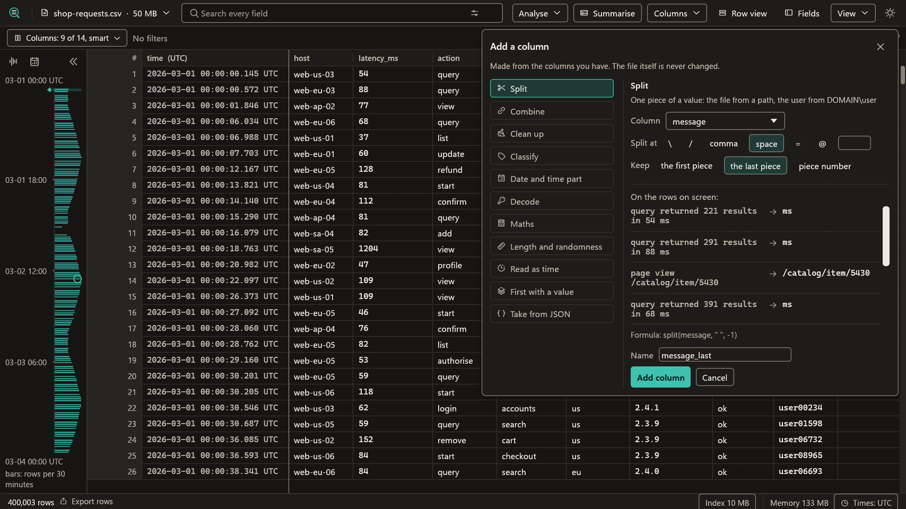

# Columns and formulas

This page covers columns you make yourself. A made column is worked out from other columns, row by row, and saved beside the file's index. The file is never changed. You make columns by filling in a small form or by picking an item from a column's menu. You do not type formulas: every form turns into a formula for you, and the formula is shown so you can see what it does. The page lists every function those formulas can use, the operators, and what happens when a value cannot be worked out.

## Made columns

A made column sits in the grid like any other column. Its header starts with a function mark (shown as ƒ) and has a dotted line under the name, so it never looks like a column from the file. Hover over the header to see what it is made from and its formula.

Made columns work everywhere a normal column does: search, filter, sort, summarise, colour rules, export. Two things differ:

- **Group rows by this column** is greyed out for a made column. Grouping by a made column is not available yet.
- A made column is kept with the file. Open the file again and it is there.

To see which columns are made, open **Columns view** (`Ctrl+2`). It marks them as made by you. The Fields panel lists them in a section named **Made by you**.

## Add a column

To make a column from a form: open the **Columns** menu and choose **Add a column: split, combine, convert**. Or right-click a column name and choose **Add a column from this one**, which opens the same sheet with that column already picked.

The sheet has a card for each kind of column on the left and its form on the right. Under the form you see the result on the rows currently on screen, with the value it starts from on the left and the result on the right. A row with no result reads **(no value)**. Under that you see the formula. Type a name, then press **Add column**. The button stays off while the form is incomplete, the result cannot be made, or the name is already used by another column.

The name is filled in for you from the card and the column. Change it if you like.

The ten cards:

**Split.** One piece of a value, such as the file from a path or the user from `DOMAIN\user`. Fields: **Column**; **Split at** (a backslash, `/`, comma, space, `=`, `@`, or any text you type in the box marked "other"); **Keep** the first piece, the last piece, or piece number N (counting from 1).

**Combine.** Join columns into one. Fields: a numbered list of columns (add and remove them), and **Put between them**, the text placed between the values.

**Clean up.** Trim spaces, change case, replace text. Fields: **Column**; **Remove spaces at both ends**; **Letters** as they are, UPPER CASE or lower case; **Replace** some text **with** other text (leave the second box empty to remove the text).

**Classify.** Label rows by rules. "The first rule that matches gives the label." Each rule picks a column, a condition, a value, and the label it **gives**. Press **Add a rule** for more. **Otherwise** is the label for rows that match no rule. The conditions are the same ones the colour rules use, such as contains, is, starts with, is more than.

**Date and time part.** The part of a time you want. Fields: **Time column**; **Part**: date, year, month, day, weekday, hour or minute. Weekday counts 1 for Monday to 7 for Sunday.

**Decode.** Fields: **Column**, then one of: Base64; Base64 of UTF-16 text (two bytes a letter); hex; host of a URL; file name of a path; folder of a path; extension.

**Maths.** Add, subtract, multiply or divide a column by a number or by another column. Fields: **Column**; the operation (**+ add**, **− subtract**, **× multiply**, **÷ divide by**); **a number** or **another column**; **Round to** N **decimal places** (on by default, one decimal).

**Length and randomness.** Fields: **Column**; **length (characters)** or **randomness (bits per character)**. The form says that plain words score about 3 to 4 and that Base64 and random names score above 4.5. Long or random-looking values often hide encoded data.

**Read as time.** Turn numbers into times. Fields: **Column**; **The numbers count** seconds, milliseconds, microseconds, nanoseconds, Windows ticks (since 1601), Chrome time, Apple time (since 2001), or spreadsheet day number.

**First with a value.** The first non-empty value of several columns. Fields: a numbered list of columns, in the order to try them.

## Convert

To turn one column into a time or decode it in one step: right-click the column name and open **Convert**. Each item opens the Add a column sheet with the right card and setting chosen and a live preview. The file is unchanged.

- **Epoch seconds to time**
- **Epoch milliseconds to time**
- **Epoch microseconds to time**
- **Epoch nanoseconds to time**
- **Windows ticks (FILETIME) to time**
- **Chrome time to time**
- **Spreadsheet day number to time**
- **Decode base64**
- **Decode base64 (UTF-16, PowerShell)**
- **Decode hex**

To only change how a column is shown, without making a new column, use **Show values as** in the same menu (see [The workspace](the-workspace.md)).

## Fields inside a JSON or XML column

When a column holds JSON or XML text, a banner appears over the rows. It reads like "request holds JSON with 14 fields inside. Make columns: ..." and has three controls:

- **Add the N that vary (of M)** adds every inner field that changes from row to row. It leaves out fields that have one value on every row and ids (long values, different on nearly every row, with no spaces). Free text such as a long message is included.
- **Choose columns** opens a window titled **Make columns**, headed "Fields inside" the column. Tick the fields you want, use **Find a field**, **Select all** or **Clear**, then press **Add**.
- The cross (hover text "Not now") hides the banner.

You can also make a single column from the row view. Open a row, find a field inside a structured value, and press **Make column** beside it. The button names the new column before it makes it.

XML elements that are labelled by their one attribute, such as `<Data Name='Image'>`, are named by that attribute, whatever it is called.

Nothing about the field names is known in advance. The fields offered are the ones found in your rows.

## Names of made columns

A column made from a field inside another column is named `column.field`, for example `request.user` and `response.user`. Two JSON columns with the same inner field never share a name. A field inside the whole raw line keeps its own name.

If you prefer short names, right-click the header of a made column and open **Name new field columns**. Choose **column.field (response.user)** or **the field alone (user)**. With the second choice, a repeat is numbered, as in `user (2)`. This only names columns you make from now on. It never renames columns already made, so the name in the header is always the name to type.

To rename a made column: right-click its header and choose **Rename this column**. The name is checked as you type. Made columns that use it follow the new name, and so does its column filter. A search you typed by hand needs the new name written in.

To remove one: right-click its header and choose **Remove this column**. The file is unchanged.

## Made columns that use other made columns

A made column can use another made column by name, in any order. For example `client`, then `client_ip` made from `client`, then `is_web` made from `client_ip`. Each column used is worked out once per row, however often it is named.

If a made column cannot be made, it is left out of the view and a line above the rows says why, in full, with a **Remove** button. The other made columns keep working.

- A loop names its columns: "loop_a uses loop_b, which uses loop_a".
- A column that uses a broken or missing one says so: "uses size_kb, which has an error".

If you remove a made column that other made columns use, a window asks first, named **Remove a made column**. You can remove it only (the others stay saved and say why they are not shown), remove them all, or keep it (**Keep**).

## Can I type a formula?

No. There is no formula box. Every made column comes from a form, a **Convert** item, or a field picked from inside a column. The formula is shown to you in two places: under the form on the Add a column sheet, and in the hover text of a made column's header.

The rest of this page lists what those formulas can contain. You will see these functions when you read a formula, and you can use the same ideas when you think about what a form produces.

## Formula reference

### Values

A formula works with five kinds of value: text, numbers, true or false, times, and no value. A time is stored to the microsecond. Text that looks like a number is read as a number when a function needs one.

Write text in double quotes: `"web"`. Inside quotes, `\"` is a quote and `\\` is a backslash. Write a column name as it is when it is made of letters, digits and `_ @ # . [ ]` and starts with a letter or one of `_ @ #`. Otherwise put it in backticks: `` `user name` ``. Column names are matched ignoring capitals. `true`, `false` and `null` are words of the language.

### Operators

From weakest to strongest:

| Operator | Meaning |
| --- | --- |
| `??` | the left side, unless it is no value or an error; then the right side |
| `or` | either is true |
| `and` | both are true |
| `not` | the opposite |
| `==` or `=`, `!=` | equal, not equal |
| `<`, `<=`, `>`, `>=` | compare as numbers or times when either side is one, else as text |
| `&` | join as text |
| `+`, `-` | add, subtract |
| `*`, `/`, `%` | multiply, divide, remainder |

Brackets group. A comparison with no value or an error on either side is never true. Dividing or taking a remainder by zero is an error: "division by zero". Arithmetic on something that is not a number gives no value.

### Text functions

| Function | Meaning | Example |
| --- | --- | --- |
| `lower(text)` | lower case | `lower(host)` turns `WEB1` into `web1` |
| `upper(text)` | upper case | `upper(status)` |
| `trim(text)` | remove spaces at both ends | `trim(user)` |
| `len(text)` | number of characters | `len(user)` |
| `left(text, n)` | the first n characters | `left(host, 3)` gives `web` from `web1` |
| `right(text, n)` | the last n characters | `right(host, 1)` gives `1` |
| `substr(text, start, [length])` | characters from position start (the first is 0), to the end or for length characters | `substr(host, 1, 2)` gives `eb` from `web1` |
| `replace(text, find, with)` | replace every exact copy of find; capitals matter; an empty find changes nothing | `replace(host, "web", "app")` |
| `contains(text, part)` | true if part is anywhere in text; ignores case | `contains(user, "admin")` |
| `startswith(text, prefix)` | true if text begins with prefix; ignores case | `startswith(host, "web")` |
| `endswith(text, suffix)` | true if text ends with suffix; ignores case | `endswith(user, "$")` |
| `split(text, separator, index)` | the piece at index (the first is 0); a negative index counts from the end; no value if there is no such piece or the separator is empty | `split(user, "\\", -1)` gives `alice` from `CORP\alice` |
| `regex(text, "pattern", [group])` | the first match of the pattern; group 0, the default, is the whole match, 1 is the first bracketed part; no value if nothing matches | `regex(host, "^[a-z]+([0-9]+)$", 1)` gives `1` from `web1` |
| `regex_replace(text, "pattern", with)` | replace every match | `regex_replace(host, "[0-9]+", "N")` gives `webN` |
| `concat(a, b, c)` | join any number of values as text; values with no value are skipped | `concat(host, "/", user)` |
| `entropy(text)` | randomness in bits per character; plain words score about 3 to 4 | `entropy(user)` |

The pattern in `regex` and `regex_replace` must be written out in quotes in the formula. It cannot come from a column. A pattern that is invalid, or too large, is refused when the column is made, with the reason. Patterns cannot run for a long time.

### JSON functions

| Function | Meaning | Example |
| --- | --- | --- |
| `json(text, "path")` | the value at a path inside JSON text: `a.b`, `a[0]`, `a[*].b` for every element (the result is a JSON list); no value if the text is not JSON or the path is missing | `json(request, "user.name")` |
| `json_len(text, ["path"])` | the number of items in a list or an object at the path, or in the whole text if no path is given; no value for anything else | `json_len(request, "items")` |

### Number functions

| Function | Meaning | Example |
| --- | --- | --- |
| `num(x)` | read as a number | `num(amount)` |
| `int(x)` | read as a number and drop the decimals | `int(amount)` gives `12` from `12.9` |
| `round(x, [digits])` | round to digits decimal places (none by default) | `round(amount / 1024, 1)` |
| `floor(x)` | round down | `floor(amount)` |
| `ceil(x)` | round up | `ceil(amount)` |
| `abs(x)` | remove the sign | `abs(amount)` |
| `min(a, b, c)` | the smallest of the numbers given | `min(amount, 100)` |
| `max(a, b, c)` | the largest | `max(amount, 0)` |

`num` and `int` give an error, "not a number: ...", when the value is text that is not a number. An empty value stays no value.

### Time functions

| Function | Meaning | Example |
| --- | --- | --- |
| `date(x, [unit])` | read x as a time. Without a unit, x is text or a number that reads as a date. With a unit, x is a number counted in `s`, `ms`, `us`, `ns`, `filetime` (Windows ticks since 1601), `webkit` (Chrome time), `cocoa` (Apple time since 2001), or `days` (spreadsheet day number) | `date(amount, "ms")` |
| `strftime(time, "format")` | write a time as text. Supported codes: `%Y` year, `%m` month, `%d` day, `%H` hour, `%M` minute, `%S` second, `%f` microseconds, `%%` a percent sign | `strftime(date(timestamp), "%Y-%m-%d")` |
| `year(time)`, `month(time)`, `day(time)`, `hour(time)`, `minute(time)` | that part of the time, as a number | `hour(date(timestamp))` |
| `weekday(time)` | 1 for Monday to 7 for Sunday | `weekday(date(timestamp))` |
| `bucket(time, "1h")` | round a time down to a whole span. A span is a number and a unit: `ms`, `s`, `m`, `h`, `d`, `w` | `bucket(date(timestamp), "15m")` |

`date` gives an error, "not a date: ...", when the text cannot be read as a time. Times are in UTC.

### Address, URL and path functions

| Function | Meaning | Example |
| --- | --- | --- |
| `cidr(ip, "10.0.0.0/8")` | true if the address is inside the network; works for IPv4 and IPv6; false if either cannot be read | `cidr(host, "10.0.0.0/8")` |
| `is_private_ip(ip)` | true for private, loopback and link-local addresses | `is_private_ip(host)` |
| `url_host(url)` | the host of a URL, without user or port | `url_host(host)` |
| `url_path(url)` | the path of a URL | `url_path(host)` |
| `url_query(url)` | the part after `?` | `url_query(host)` |
| `path_dir(path)` | the folder of a path (separators `\` or `/`) | `path_dir(host)` |
| `path_file(path)` | the file name of a path | `path_file(host)` |
| `path_ext(path)` | the extension, without the dot; empty if there is none | `path_ext(host)` |

### Decoding functions

| Function | Meaning | Example |
| --- | --- | --- |
| `base64_decode(text, ["utf16"])` | decode Base64 to text. With `"utf16"` the bytes are read as UTF-16, two bytes a letter, as PowerShell encodes commands. An empty value stays no value; text that is not Base64 is an error, "not base64: ..." | `base64_decode(user, "utf16")` |
| `hex_decode(text)` | decode hex digits to text; non-hex characters are skipped; text with fewer than two hex digits is an error, "not hex: ..." | `hex_decode(user)` |

### Choosing and testing

| Function | Meaning | Example |
| --- | --- | --- |
| `if(condition, then, else)` | one value or the other. If the condition is an error, the result is that error | `if(amount > 100, "high", "low")` |
| `case(cond1, value1, cond2, value2, default)` | the value of the first condition that is true; the last value is the default; with no default the result is no value | `case(status == 200, "ok", status >= 500, "fail", "other")` |
| `coalesce(a, b, c)` | the first value that is neither no value nor an error | `coalesce(user, host, "unknown")` |
| `isnull(x)` | true if x is no value. An error is not no value | `isnull(user)` |
| `iserror(x)` | true if x could not be worked out | `iserror(num(amount))` |
| `iferror(x, instead)` | x, or instead when x is an error | `iferror(num(amount), 0)` |

## Two kinds of empty: no value and could not be worked out

A made column can fail on one row and succeed on the next. LogSeek keeps two kinds of empty apart.

**No value** means the input was missing or the function found nothing. A split with no such piece, a regex with no match, a missing JSON path: all give no value. The cell is empty. The Fields panel and Summarise list these rows as **(no value)**.

**Could not be worked out** means the value was there but was wrong for the job. Text in `num`, a date that is not a date, text that is not Base64, a division by zero. The cell shows a warning mark. Hover over it to read why, for example "not a number: n/a", "division by zero", "not a date: ...", "not base64", "not hex".

How errors travel:

- An error passes through every later step with its reason. Joining text with `&`, arithmetic, and any function that receives it all pass it on.
- Only `coalesce`, `??` and `iferror` replace an error. `iserror` asks whether a value is one. `isnull` is for missing values only and is false for an error.
- An error matches no comparison. `==`, `<`, `>` and the others are never true with an error on either side.
- `and` and `or` pass an error on, unless the side before it has already decided the answer. `not` of an error is an error.
- An error is not empty.

### Searching, counting and exporting errors

- "Is not" means "not (is)". A made column that holds an error is kept by a "not" filter, just as rows with no value are.
- `EMPTY` leaves error rows out. `NOT EMPTY` keeps them.
- In the search box, `iserror(size_kb)` finds the rows where `size_kb` could not be worked out. In a column filter, write `(could not be worked out)`. The word ERROR on its own is an ordinary value.
- The filter strip shows it as a chip: "size_kb could not be worked out".
- The Fields panel shows a line named **(could not be worked out)**, separate from the values and from **(no value)**. Click it to show only those rows. `Alt`+click leaves them out.
- **Summarise** shows the same group as **(could not be worked out)**. Click it to see its rows.
- **Copy as table** and exports write an error as an empty cell.

## What is not done

- Grouping by a made column is not available yet.
- You cannot type a formula yourself.

See [Limits and known gaps](limits-and-known-gaps.md) for the full list.
