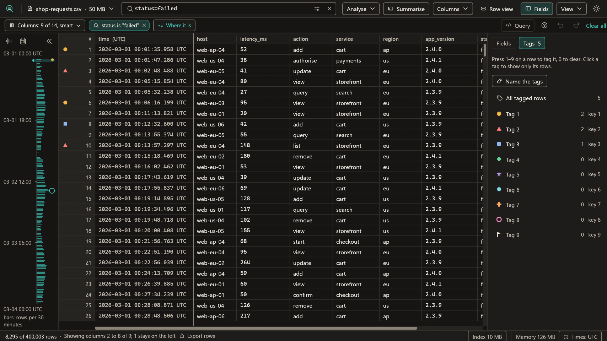

# Export and sharing

This page covers how to get rows, values and findings out of LogSeek Studio: exporting the rows a search keeps to a file, the different ways to copy, passing a view to someone as one line, and using tags to mark rows you want to come back to. Your original file is never changed by any of this. LogSeek writes new files only where you choose.

## Export rows

To save the rows you are looking at to a file:

1. Narrow the rows with a search or filters, if you want only some of them. The export takes exactly the rows the search keeps.
2. Choose **Export rows** at the left of the status bar. (You can also press `Ctrl+K` and type "export".)
3. Under **As**, choose the format.
4. Under **Columns**, choose **all N** columns, or **the N shown in the grid** (the columns you have not hidden, in the grid's order).
5. Choose **Choose where to save**, and pick a file name. The suggested name is the source name followed by "(export)", for example `access (export).csv`.

The export runs in the background. The status bar shows "Exporting 120,000 of 603,813 rows" with **Cancel**. You can keep working while it runs. Cancelling removes the partly written file. When it finishes, a message gives the number of rows and the path in full, with **Show in folder** and **Dismiss**.

### Formats

- **CSV (spreadsheets)**: a header row of column names, then one line per row. Values that contain a comma, a quote, a line break, or a leading or trailing space are quoted. Empty and missing values are written as empty cells.
- **Excel workbook (smaller file)**: an `.xlsx` file, usually far smaller than the same rows as CSV. Every value is written as text, so nothing is changed and nothing runs as a formula. A sheet holds 1,048,576 rows; more rows go on to further sheets named **Rows 2**, **Rows 3** and so on, each with the column names. A value longer than a workbook cell holds (32,767 characters) is kept whole, in pieces, on a sheet named **Long values**, and its own cell says where to find it.
- **JSON Lines**: one JSON object per row, with the column names as keys. A missing value is written as `null`. Every other value is written as a JSON string, numbers included. There is no header line.

### Spreadsheet safety in CSV

A cell that starts with `=`, `+`, `-`, `@`, a tab or a carriage return would be run as a formula by a spreadsheet. In CSV, such a cell gets a leading `'` so the spreadsheet opens it as text. Plain numbers such as `-5` or `+3.25` are left as they are. JSON Lines is not changed this way.

### What an export holds

- Every row the search keeps, with no cap. The totals shown are exact.
- Made columns are exported like any other column, if you choose them.
- Large exports are written in pages sized by bytes, so very wide rows do not fill memory.
- The file is written under a temporary name and renamed when complete, so a failed export does not leave a half-written file under the final name.

## Copy

Every copy tells you what it copied, for a few seconds, for example "Copied the value of user (12 characters)".

To copy a value or a row from the grid:

- `Ctrl+C` copies the focused cell. If several rows are selected, it copies those rows instead.
- With several rows selected, `Ctrl+C` writes them tab-separated, in the column order on screen, ready to paste into a spreadsheet. `Ctrl+Shift+C` puts the column names first.
- Right-click a cell: **Copy value** copies the cell. **Copy row** copies the row tab-separated. With several rows selected the menu offers **Copy the N selected rows** and **Copy them with the column names**.
- Right-click a column name and choose **Copy this column** to copy every value of that column in the rows shown, with its name first.

To select rows to copy: click, `Shift`+click for a range, `Ctrl`+click to add or remove, `Shift+Up` or `Shift+Down`, or `Ctrl+A` for all rows. Row selection works in the plain list, in sorted order too. It does not work in the grouped view or in the Follow tree. Only the focused cell copies there.

To copy from the row view (press `Space` or `Enter` on a row): every field has a copy button. **Copy row** offers:

- **As JSON**
- **As text (name = value)**
- **As CSV (names, then values)**
- **The line from the file** (the raw line exactly as it is in the file)

Right-click a value in the row view for **Copy value** and **Copy  field = value**.

To copy results: **Copy as table** in Summarise and in **What sets these rows apart?** writes every group or line. **Copy the table** in Search a list writes every keyword with its rows, cells and columns. Empty and not-worked-out cells are written as empty.

A copy larger than a quarter of the memory budget is refused with a pointer to **Export rows**. Use an export for large sets.

## Pass a view on as one line

To send someone the same view: open the **Query** receipt on the filter strip (shown while something filters) and choose **Copy**. The text holds the search, the sort and the shown columns as one line, for example `host:web1 status>=500 | sort -bytes | fields time, host, status`. Pasted into the search box of another window with the same columns, it gives the same rows in the same order with the same columns. See [Searching and filtering](searching-and-filtering.md).

## Tags as evidence marks

Tags are nine marks you put on rows to keep track of them. They are the way to mark evidence as you work.

To tag a row: select it and press `1` to `9`. Press the same key again to remove that tag. Press `0` to clear all tags from the row. You can also right-click a cell and use **Tag**, or use the **Tag** menu in the row view. A row can carry more than one tag.

- Each tag has its own colour and its own shape. Colour is never the only cue.
- Tags have no built-in meaning. They are called "Tag 1" to "Tag 9" until you name them. To name them, open the **Fields** panel (`Ctrl+B`), choose the **Tags** tab, and choose **Name the tags**. Names are kept for every file. An emptied name goes back to its number.
- To see only tagged rows: in the **Tags** tab, click **All tagged rows**, or click one tag to show only its rows. A chip appears in the status bar ("tagged rows only") and the tab shows counts for each tag. **Show all rows** brings the full set back.
- On the time spine, tagged rows sit in a lane at the right edge, each in its tag's shape and colour. Hovering shows how many tagged rows a stretch holds, and a click goes there.
- From tagged rows you can start **Follow related rows** to find the rows that link to them. See [Analysis](analysis.md).

Tags are saved beside the index, never in your file. They are written atomically so a crash cannot corrupt them. If the file has changed since the tags were saved, the status bar warns that the tags were saved for a different version of the file.

To get tagged rows out: tag them, filter to **All tagged rows**, then use **Export rows** or `Ctrl+A` and `Ctrl+C`. There is no separate tag column in an export, and a tag does not appear as a field in exported rows.

