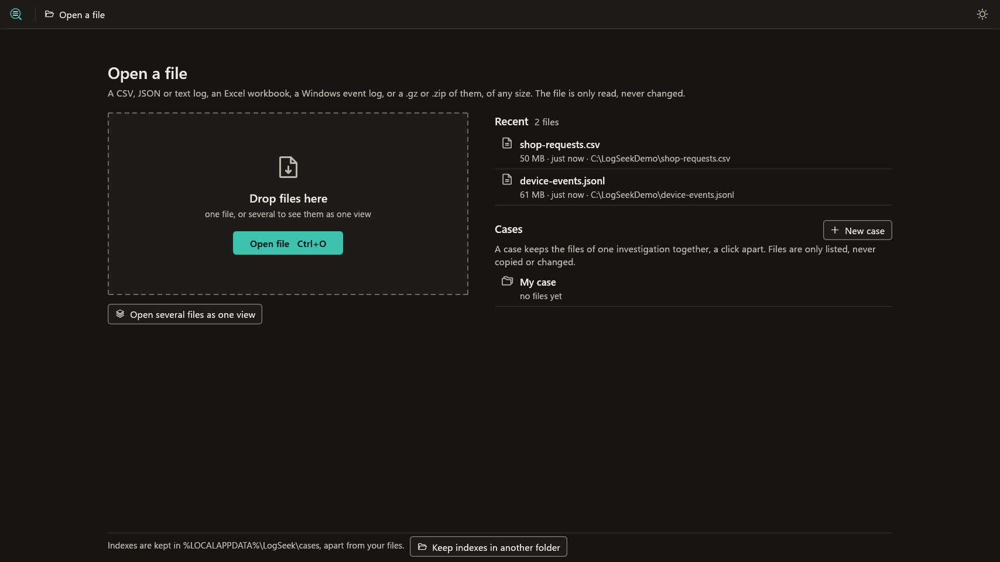
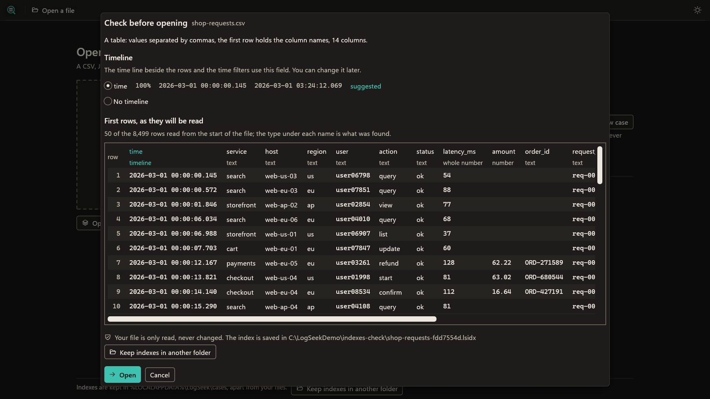

# Getting started

This page covers opening your first file: how to open one, what the **Check before opening** sheet asks you, how to open several files as one view, how to keep files together in a case, how workbooks, packed files and Windows event logs open, where the index of each file is kept and how to move it, and how to start a file from scratch. LogSeek Studio only reads your files. It never changes them.

## What opens

LogSeek Studio opens these kinds of file:

- Tables and text: `.csv`, `.tsv`, `.psv`, `.txt`, `.log`
- JSON: `.json`, `.jsonl`, `.ndjson`. This covers one record per line, a JSON array, records inside a wrapper key, and pretty-printed JSON.
- Workbooks: `.xlsx`, `.xlsm`, `.xlsb`, `.xls`, `.ods`
- Windows event logs: `.evtx`
- Packed files: `.gz`, `.zip`

The file dialog also offers **All files**. When you add a folder to a case, a file with no extension is included if it looks like text. Nested JSON fields become columns named like `a.b.c`.

## Open a file

To open a file, use any one of these:

1. Press `Ctrl+O`, or choose **Open file** on the start screen, and pick the file.
2. Drop the file on the window. If you drop several, they open as one view.
3. Click a name under **Recent** on the start screen. Every file you opened before is listed with its size and when you opened it; the list scrolls. A file that has moved or been deleted shows "Not found".
4. Give the file to the program on the command line, or use Open with in Explorer.

Once a file is open, the file name in the top bar opens the case panel. From there you can open another file.

## Check before opening

The first time you open a file, before any index exists, LogSeek shows **Check before opening**. Nothing is indexed until you accept it. The sheet shows:

- **How it will be read.** A plain sentence, for example that the file is a table with values separated by commas, the first row holds the column names, and it has 8 columns.
- **Timeline.** Every field that reads as a time. Each line gives how full the field is in the first rows and its range of times, and the suggested field is marked "suggested". Pick one, or choose **No timeline**. If a field holds epoch seconds or milliseconds, the line says so.
- **First rows, as they will be read.** The first rows of the file, with row numbers. The type found sits under each column name. The timeline column is shown in the accent colour.
- **Where it goes.** A reminder that the file is only read, and the folder where the index will be saved.

To name columns: if the file has no row of names (a headerless log or CSV), a box sits above each column. Type a name over any column. Leave a box blank to keep the column's number. If a name is already used, it is numbered. The timeline follows a renamed time column.

If column names were repeated or empty, the sheet tells you what each one was renamed to.

Press `Enter` to open and `Esc` to cancel.

### Files with no header

A text log with no header, such as a web server access log, is read as columns worked out from the lines themselves. Each line is split into words, `"quoted"` groups, `[bracketed]` groups and comma chains. When most lines share the same parts, each part becomes a column. When lines run on with free text after a few fixed parts, the shared parts become columns and the message stays whole. Anything that does not fit goes in a column called `_rest`, and the number of such lines is reported. Lines that start with `#` are not rows.

## Open a file again

LogSeek keeps your work with each file: tags and made columns next to its index, and the view (search and filters, sort, hidden columns, grouping). Open the file again and it comes back as you left it. One line under the search box says what came back, for example:

"Opened as you left it: the search and filters, 2 hidden columns, tags on 3 rows and 1 made column (user)."

Beside that line are two buttons: **Start from scratch** and **OK**. **OK** hides the line.

## Start a file from scratch

To start a file from scratch, choose **Start from scratch** on that line. You can also open the case panel (click the file name in the top bar) and choose **Start this file from scratch**. A sheet asks what to clear. Tick what you want and choose **Clear the ticked**:

- **The search, filters, sort, hidden columns and grouping.** Undo brings this back.
- **Tags.** This cannot be undone.
- **Made columns.** This cannot be undone.
- **Read the file again.** The index is removed and the file is read afresh. Use this when a newer version of LogSeek reads something better, such as a new time format, the columns of a headerless log, or event-log names. Tags and made columns stay, on the same row numbers.

An item with nothing set is greyed out. The file itself is never changed.

## Open several files as one view

To see several files as one set of rows:

1. Press `Ctrl+O`, or choose **Open several files as one view** on the start screen.
2. Pick two or more files in the dialog.

You can also use **Open these N as one view** in the case panel, or give several files on the command line.

One index is built over all of them. Each file is read its own way. Columns are matched by name, so a column one file lacks is empty on its rows. Files with no header line up by position. A `_file` column says which file each row came from. You can filter, summarise or colour by it like any column. Rows keep the files' order. To get one timeline, sort by the time column.

The top bar shows the count and total size, for example "6 files · 224 MB", and lists every file when you hover over it. Recent files, tabs, kept views and tags work for the set as they do for one file. The index goes out of date when any file in the set changes.

## Cases

A case is a named list of the files of one investigation. Files are only listed. They are never copied, moved or changed.

To work with a case, click the file name in the top bar, or choose **Cases** on the start screen.

- **Add files** adds files to the case.
- **Add a folder** adds every readable file in a folder, at every level. Files LogSeek cannot read are left out, and the panel counts them by kind.
- **Find a file (several words narrow it)** narrows the list.
- Click a file to open it. The list shows size and index state for each file.
- **Open these N as one view** opens the files listed (or the ones your find words narrowed it to) as one view.
- **Open a file without adding it** opens a file but does not list it.
- **New case** starts another, empty case. Use **Switch case** to move between cases. Type in the case name box to rename a case.

## Workbooks, packed files and event logs

These open a small sheet first.

**Workbooks** (`.xlsx`, `.xlsm`, `.xlsb`, `.xls`, `.ods`). The sheet is titled **Workbook** and lists each sheet with its rows and columns. Sheets hidden in Excel are marked "hidden in Excel". Click a sheet name to open it, or choose **Open all N**. Each sheet becomes its own tab and works like any file. Formula cells show the result saved in the workbook. LogSeek does not recalculate them. Cell colours, merged cells and number formats other than dates are not carried over. If rows above the column names only title the sheet, they are not taken for names or for rows, and the status bar says so.

**Packed files** (`.gz`, `.zip`). The sheet is titled **Packed file**. A zip lists the files inside with their sizes, how much disk space unpacking needs and how much is free. Click one, or choose **Open all N**. Each file is unpacked once to a working copy, kept until the packed file changes, and then opens like any file. If the disk is too small, LogSeek says so and does not unpack. The packed file is never changed.

**Windows event logs** (`.evtx`). The sheet is titled **Windows event log**. Each event becomes a row. The columns are named by the event's own structure: its header fields first, then the event's own data fields. The timeline is found from the values like any other file's. Events in damaged parts of a log are counted and reported.

## Where indexes are kept

Each file gets an index. The default folder is `%LOCALAPPDATA%\LogSeek\cases`. Each index is a `.lsidx` file named after the source with a short hash. The index holds your tags and made columns as well.

To see where this file's index is, click the index size in the status bar (it reads like "Index 12 MB"). The menu shows **This file's index** and its folder.

To move where new indexes are kept, press **Keep indexes in another folder** in any of these places, then pick a folder on a drive with room:

- the bottom of the start screen, beside the line that names the folder in use;
- the **Check before opening** sheet, under the folder where this file's index will be saved;
- the menu behind the index size in the status bar, once a file is open (there it reads **Keep new indexes in another folder**).

LogSeek checks that it can write to the folder you pick. If it cannot, it says so and changes nothing. Only new indexes go to the new folder. Files indexed before keep theirs where they are. To go back, choose **Use the usual folder again** on the start screen or in the status bar menu.

If disk space is short, LogSeek keeps less on disk and reads the rest from the file in place. With no space at all it keeps the index in memory. The menu then says to choose a folder on a drive with room and open the file again.

## Next steps

- [The workspace](the-workspace.md): the screen, the grid, columns, tags and colour rules.
- [Searching and filtering](searching-and-filtering.md)

## When a file is not read cleanly

LogSeek counts what it could not read as it indexes a file, and says so above the rows when the import is done. Each kind of problem gets one sentence with exact counts, for example rows with more or fewer values than the header, records that are not valid JSON, lines with an unmatched quote, data left unread after the list of records in a JSON file, or a part of the file that had to be skipped. Press **Dismiss** to hide the note for that file.

A file encoded as UTF-16 is not read correctly yet: save a copy as UTF-8 first.

## List files that arrive with other files

When you open several files as one view, LogSeek keeps a small list of them in its own data folder. If you open a `.lsset` list that came from somewhere else, LogSeek treats it with care: it keeps the index in its own data folder, never beside the list, and it only opens files that sit in the list's own folder. A list that names a file anywhere else is not opened, and LogSeek says which file it was.
