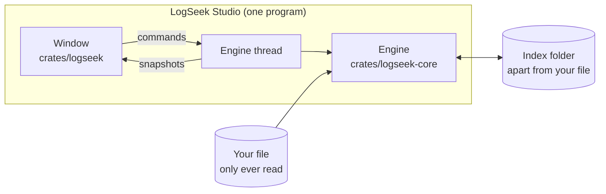
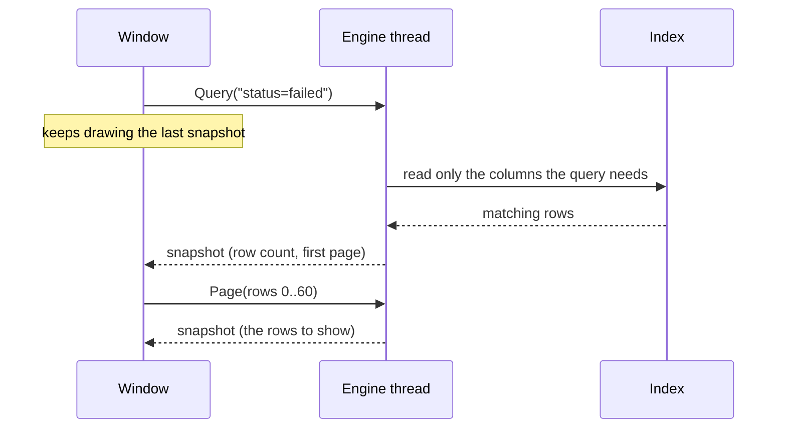
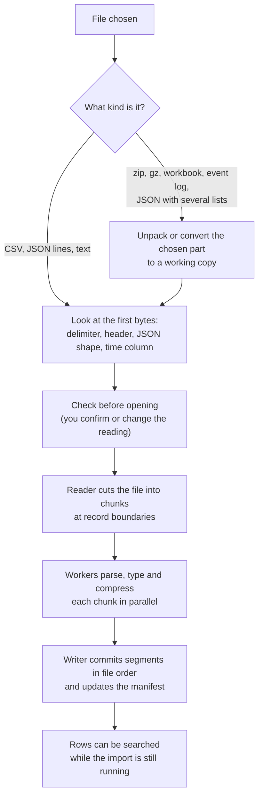
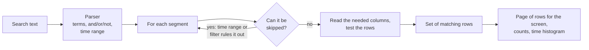

# How it works

This page describes how LogSeek Studio is put together: what happens when a file is opened, where the index lives, and how a search is answered. It is for people who want to understand the program or work on its code.

## The two parts

LogSeek Studio is one program built from two Rust crates.

| Crate | What it is |
| --- | --- |
| `crates/logseek-core` | The engine. It reads files, builds the index, answers queries and keeps to a memory budget. It has no user interface. |
| `crates/logseek` | The window. It draws the screen with [egui](https://github.com/emilk/egui) and talks to the engine. |

## The window never waits for the engine

The engine runs on its own thread. The window sends it commands (open this file, run this search, give me rows 200 to 260) and carries on drawing. When the engine has something new, it publishes a snapshot, which is an unchanging picture of the current state, and asks the window to repaint.

Because the window only ever reads the latest snapshot, a long search or a large import cannot freeze it. A newer command replaces an older one of the same kind that has not started yet, so typing quickly does not queue up work.

## Opening a file

A few points about this path:

- **Detection** works from the start of the file. It decides the delimiter and header for a table, the shape for JSON (one record per line, a list, a wrapped list, records over several lines), and which column is the timeline. The Check before opening sheet shows these choices and lets you change them.
- **Chunks** are cut where a record ends, so a quoted line break in a CSV cell or a multi-line JSON record is never split.
- **Order is kept.** Workers run in parallel, but the writer commits their results in file order, so row numbers always match the file.
- **An import can stop and resume.** Each committed segment is complete on disk. Cancelling keeps what was read; opening the file again carries on from there.
- **What cannot be read is counted.** A broken row or an unfinished record is skipped, counted and reported above the rows.

## The index

The index is a folder kept apart from your file (by default under `%LOCALAPPDATA%\LogSeek\cases`; you can choose another place). It holds:

| File | What it holds |
| --- | --- |
| `manifest.json` | How the file was read, its columns and their types, and the list of segments |
| `seg\*.kseg` | The rows, stored column by column |
| Small side files | Tags, columns you made, the saved order of a sort, and similar |

A **segment** is a block of rows stored one column at a time. Each column is compressed in the way that suits it: a dictionary for values that repeat, plain numbers for numeric columns, times as numbers with a note of how they were written so they can be shown exactly as in the file. A segment also carries a small filter per column that can say "this value is definitely not here", which lets a search skip whole segments.

Opening a segment reads only its footer. A column is read from disk only when a query or the screen needs it, so a search over two columns of a 120-column file reads two columns.

## Answering a search

- The search box, the filter chips and Build a search all produce the same query text, and one parser reads it. That is why any view can be passed on as one line.
- Segments are scanned in parallel, leaving one processor core free for the window.
- The result is a set of matching row numbers. The screen then asks only for the rows it is showing, so scrolling through millions of matches stays quick.
- Counts are exact. Summaries, groups and value lists are worked out over all matching rows, not a sample.

## Analysis

The analysis sheets (unusual rows, what sets rows apart, patterns, shapes, strange text, rare pairs, timeline signals, follow related rows) are each a module under `crates/logseek-core/src/query`. They all work the same way: they read the columns they need from the index for the current rows and compute their answer from that data alone. None of them uses a built-in list of known values or names.

## Columns you make

A made column is a formula kept beside the index, for example `json(payload, "user.id")` or `split(path, "\", -1)`. It is evaluated when rows are read, and the file is not changed. Removing the column removes the formula and nothing else.

## Memory

Every large buffer is reserved from one budget before it is allocated: import chunks, decoded columns, aggregation tables, sort runs and the page cache. When a reservation is refused, the work adapts by using smaller batches, writing to disk, or dropping cached columns. The budget grows while heavy work needs it and shrinks back when the work ends, which is why memory use falls again a short while after a large search.

## Where to look in the code

| Area | Path |
| --- | --- |
| File kinds and detection | `crates/logseek-core/src/ingest/detect.rs` |
| Import pipeline | `crates/logseek-core/src/ingest/pipeline.rs` |
| Readers (CSV, JSON, workbooks, event logs, packed files) | `crates/logseek-core/src/ingest/` |
| Segment format | `crates/logseek-core/src/segment/` |
| Opened index | `crates/logseek-core/src/store/` |
| Query parser and execution | `crates/logseek-core/src/query/parser.rs`, `exec.rs` |
| Analysis | `crates/logseek-core/src/query/` |
| Formulas | `crates/logseek-core/src/formula/` |
| Memory budget | `crates/logseek-core/src/budget.rs` |
| Engine thread, commands and snapshots | `crates/logseek/src/bridge.rs` |
| The window | `crates/logseek/src/app.rs`, `grid.rs` |

To build and test, see [Building it yourself](building.md).
