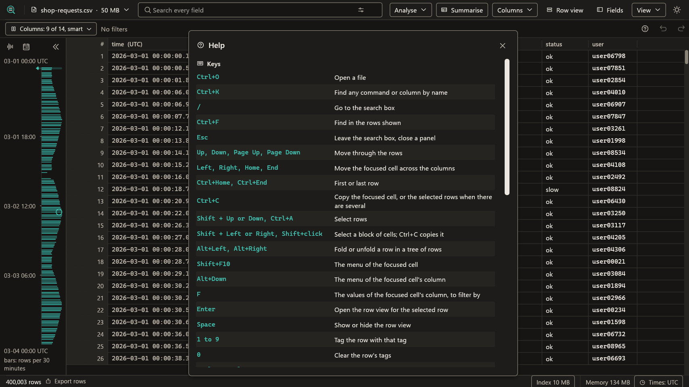

# Keyboard

This page lists every key LogSeek Studio answers to, grouped by what you are doing. Press `?` in the app to see the main list on screen. Single-key shortcuts (`1` to `9`, `0`, `F`, `Space`, `/`, `?`) pause while you are typing in a text box, so they never get in the way of what you type. Where a key says `Ctrl`, it is `Ctrl` on Windows.

## Files, windows and views

| Key | What it does |
|---|---|
| `Ctrl+O` | Open a file |
| `Ctrl+K` | Find any command or column by name |
| `Ctrl+T` | New tab: another view of the same file with its own search and filters |
| `Ctrl+W` | Close the tab |
| `Ctrl+Tab` | Next tab |
| `Ctrl+Shift+Tab` | Previous tab |
| `Ctrl+B` | Show or hide the Fields panel |
| `Ctrl+Shift+B` | Fold the time rail away, or bring it back |
| `Ctrl+G` | Choose columns, with the find box ready |
| `Ctrl+2` | Columns view: every column as one row of a table |
| `Ctrl+1` | Back to the rows |
| `Ctrl+E` | Open or close the query workspace |
| `Ctrl` + plus, `Ctrl` + minus | Zoom in, zoom out |
| `Ctrl+0` | Normal size |
| `Ctrl` + mouse wheel | Zoom |
| `?` | Show or hide the help sheet |
| `Esc` | Leave the search box, or close the open panel or sheet |

## Searching

| Key | What it does |
|---|---|
| `/` | Go to the search box |
| `Ctrl+L` | Go to the search box (also works while typing elsewhere) |
| `Enter` (in the search box) | Run the search now. Otherwise it runs a moment after you stop typing. |
| `Alt+Enter` | Use the reading shown under the search box when you typed plain words |
| `Ctrl+F` | Find in the rows shown |
| `Enter`, `Shift+Enter` (in the Find bar) | Next match, previous match |
| `Ctrl+Shift+F` | Search every cell for a keyword |
| `Up`, `Down` (in the Search every cell window, with its box active) | Step through the matches |
| `Ctrl+Enter` (in the query workspace) | Run the query |
| `Ctrl+Z` | Step back through filter changes |
| `Ctrl+Y` or `Ctrl+Shift+Z` | Step forward through filter changes |

## Moving through the rows

| Key | What it does |
|---|---|
| `Up`, `Down` | Move the selected row |
| `Page Up`, `Page Down` | Move one screen |
| `Ctrl+Home`, `Ctrl+End` | First or last row |
| `Left`, `Right` | Move the focused cell one column left or right |
| `Home`, `End` | Move the focused cell to the first or last shown column |
| `Enter` | Open the row view for the selected row |
| `Space` | Show or hide the row view |
| `Shift` + mouse wheel | Scroll sideways |
| Middle mouse button | Click it to scroll by moving the pointer away from that spot, faster the farther you go; click again, press `Esc` or click anywhere to stop. Or hold it and drag |

On a group header, `Right` opens the group and `Left` closes it, or goes to its parent group. `Enter` opens or closes a group header, or opens the row view on a row. In a tree of rows (a Follow result), `Alt+Right` unfolds the selected row and `Alt+Left` folds it, or goes to the row it links to. `Alt+Left` and `Alt+Right` also work on group headers.

## Selecting and copying

| Key | What it does |
|---|---|
| `Shift+Up`, `Shift+Down` | Select a range of rows |
| `Shift+Left`, `Shift+Right`, `Shift` + click | Select a block of cells, from the focused cell to where you stop |
| `Ctrl+A` | Select every row in the plain list |
| `Ctrl+C` | Copy the focused cell, the selected block of cells, or the selected rows when there are several |
| `Ctrl+Shift+C` | Copy the selected rows with the column names first |

## The focused cell and its menus

| Key | What it does |
|---|---|
| `Shift+F10` | Open the menu of the focused cell |
| `Alt+Down` | Open the menu of the focused cell's column |
| `F` | Open the values of the focused cell's column, to filter by |

## Tags

| Key | What it does |
|---|---|
| `1` to `9` | Tag the selected row with that tag. Press again to remove it. |
| `0` | Clear all the row's tags |

## The time spine

Press `Tab` until the time rail has the focus. A ring shows where the keyboard is.

| Key | What it does |
|---|---|
| `Up`, `Down` | Move the rows stretch by stretch |
| `Page Up`, `Page Down` | Move ten stretches |
| `Home`, `End` | First or last stretch |
| `Enter` | Keep the stretch as a period |
| `Esc` or `Backspace` | Step out of the kept period |

With the pointer over the rail and no text box active, `Esc` also steps out of a kept period.

## Sheets and dialogs

| Key | What it does |
|---|---|
| `Esc` | Close the sheet: Summarise, Add a column, calendar, Search a list, Search every cell, Unusual rows, What sets these rows apart, the help sheet and others |
| `Enter` | Confirm a dialog with a name box, such as saving a search or renaming a column. In "Check before opening", `Enter` opens the file and `Esc` cancels. |

In "Check before opening", `Enter` opens the file only when no button has the keyboard focus, so a focused **Cancel** is never overridden.

## Mouse-only actions

A few actions have no key yet: the column header's right-click menu (use `Alt+Down` on a focused cell for the column menu instead), dragging on the time spine to keep a period (use `Tab` and `Enter` on the rail instead), and the calendar's hour strip. See [Limits and known gaps](limits-and-known-gaps.md).
