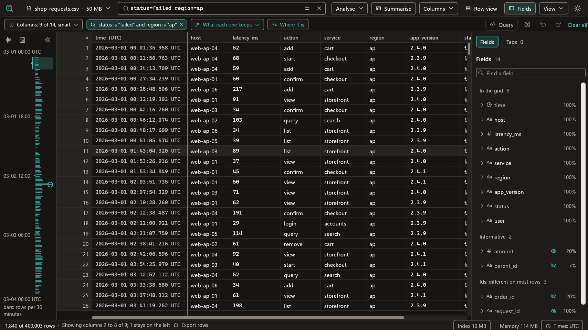
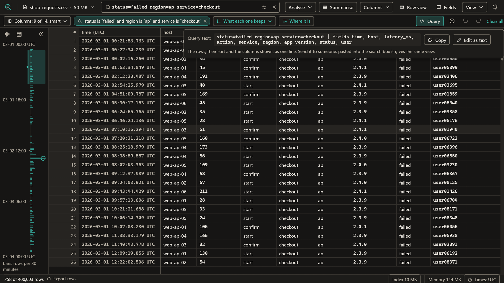
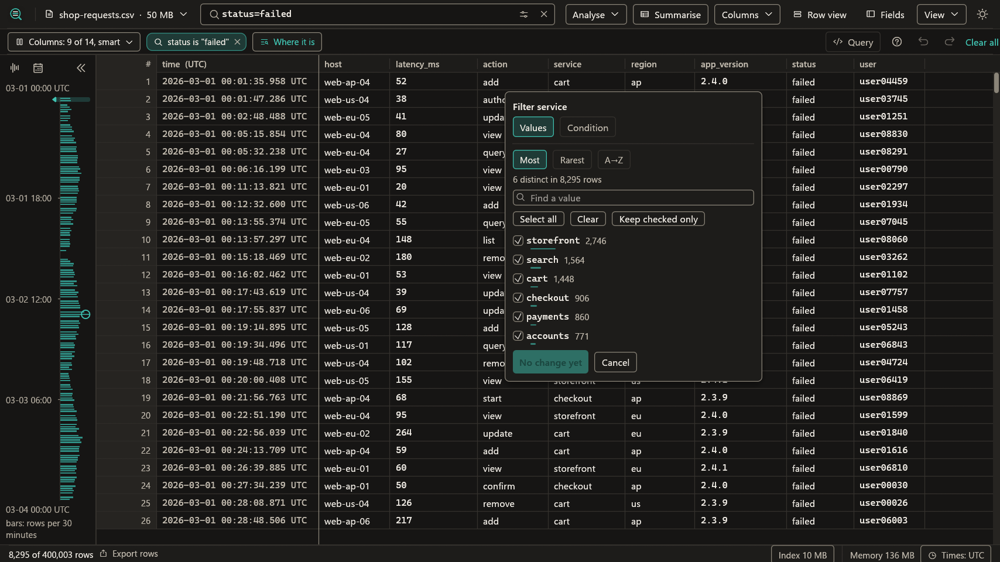
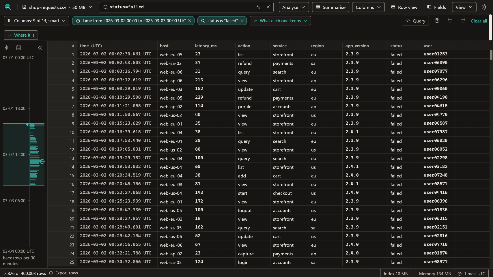
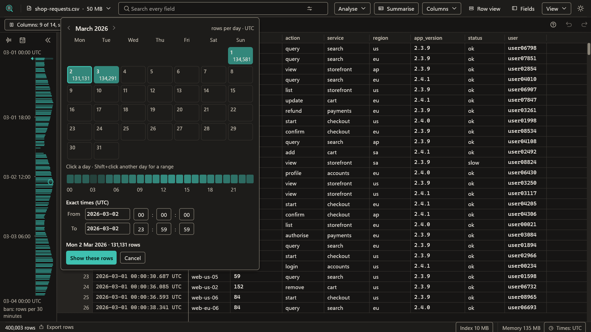
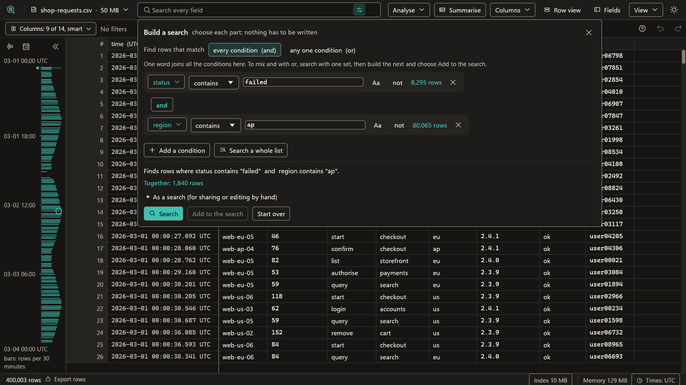

# Searching and filtering

This page covers every way to narrow the rows you see: the search box and its syntax, the filter chips, the value list and Condition tab on each column, time periods (the time spine and the calendar), quiet gaps, Build a search, searching a whole list of keywords, saved searches, the query workspace, Find, and undo and redo. Nothing here changes your file. Every filter only decides which rows are shown, and the status bar always gives the exact count of rows kept.

## The search box

The search box is at the top of the window. Press `/` or `Ctrl+L` to jump to it. Press `Esc` to leave it.

To search for text: type it. The search runs a moment after you stop typing. Press `Enter` to run it at once. A plain word is looked for in every field of every row, ignoring capitals.

To clear the search: use the cross at the right end of the box. A kept time period stays; its chip removes it.

To see what a search means: hover over the box. A tip headed "This search means" gives the search in words, for example `host contains 8105` or `EventID > 1`. If you wrote a quoted piece of text that contains `<`, `>` or `=`, the tip warns that it is literal text and that you should drop the quotes to make a comparison.

If a search cannot run, the box is marked and hovering over it gives the reason. A search that cannot run is reported, never skipped. An unknown column name is reported with the closest column name as a suggestion, for example "unknown column hots - did you mean host?".

### Plain words

You can type ordinary words instead of search syntax, such as `cancelled from hyderabad above 15k` (an example for a file with such columns). While you type, a slim line under the search box shows how this file reads your words. Each part is a chip. The line gives the number of rows the reading would keep.

- Press `Alt+Enter`, or choose **Use**, to put that reading into the search box. Until you do, the search box is not changed.
- A word that fits more than one column is offered with the likelier reading first. The other readings are in the chip's menu.
- A word the file does not know is looked for as text, and the line says so.
- Words that ask for a summary, such as "average total by city per hour", open **Summarise** set up that way.
- To keep your words as they are, dismiss the line.
- Nothing is read as plain words once the text uses search syntax: any of `=`, `~`, `@`, `<`, `>`, a backtick, `(`, `|`, a word containing `:`, or the capitalised words `AND`, `OR`, `NOT`.

The words come from your file: column names split into words, and the values of columns that have up to 20,000 different values. Only small words of the language are built in (such as over, under, between, not, without, empty, by, per, last).

### Search syntax

You write a term as a column name, an operator and a value. Column names are matched ignoring capitals.

| You write | It keeps rows where |
|---|---|
| `error` | any field contains the text, ignoring capitals |
| `"disk full"` | any field contains the exact text in quotes (use quotes for spaces) |
| `host=web1` | the value of `host` is exactly `web1`, ignoring capitals |
| `host==web1` or `host = web1` | the same as `host=web1` |
| `host!=web1` or `host<>web1` | `host` is not `web1`. Rows with no value are kept. |
| `host:web` | `host` contains `web`, ignoring capitals |
| `host:web*` | the whole value matches the pattern. `*` stands for any run of characters, `?` for one character. A `*` anywhere in a `:` term turns it into this whole-value pattern. |
| `status>=500`, `status>499`, `status<=299`, `status<300` | the value compares as a number, or as a date or time when the value you wrote is one. Text is compared ignoring capitals. |
| `user~/^adm.*/` | the value matches the regular expression. Capitals matter unless you start the pattern with `(?i)`. |
| `~/timeout/` | the regular expression matches in any field |
| `user:*` | `user` has a value |
| `NOT user:*` | `user` is empty |
| `iserror(size_kb)` | the made column `size_kb` could not be worked out in that row |

Things to know:

- Spaces around the sign are accepted: `EventID = 1`, `EventID =1` and `EventID= 1` all work.
- A column name with spaces or odd characters goes in backticks: `` `source ip`=10.0.0.1 ``. A value with spaces goes in double quotes: `msg="disk full"`. Inside quotes, write `\"` for a quote and `\\` for a backslash.
- "Is not" means "not (is)". `user!=x` and `NOT user=x` give the same answer, and both keep rows where `user` has no value.
- A row with no value matches no comparison such as `>` or `=`. An error value in a made column matches no comparison either.
- The search box has no `5~10` range. For a numeric range write both ends: `amount>=5 amount<=10`. For a time range use `@from..to`, below. The `5~10` form belongs to column filters (see "Filter words" below).
- Regular expressions are checked as you type for plain mistakes, such as an unclosed bracket. The engine limits the size of a pattern, so no pattern can hang the app.

### Joining terms

- Write terms one after another, or with `AND`, to require all of them.
- Write `OR` between terms to accept either. `AND` binds tighter than `OR`.
- Write `NOT` (or `!` in front of a word) to leave out what follows.
- Use parentheses to group: `status>=500 AND (host:web1 OR host:web2)`.
- Write `AND`, `OR` and `NOT` in capitals. If you write `or`, `and` or `not` in lower case between two terms, the box does not guess. It tells you to write the word in capitals to mean the operator, or to put it in quotes to look for the word itself.

### A time range in the search

Write `@from..to` anywhere before the first `|`: `@2026-11-01..2026-11-03 status>=500`. The range includes the start and excludes the end, in UTC. A date alone means midnight. The range is never searched as text.

When a period is kept by the time spine, the calendar or a drag, it appears as a chip and the search box holds only the words you typed.

### Pipe steps

A search can end with steps after a `|`. Only these work in the rows:

- `| where condition` adds one more condition. It is the same as `AND`.
- `| sort column` sorts the grid by that column, smallest first. `| sort -column` sorts largest first. Only one column is accepted.
- `| fields a, b, c` shows only those columns, in that order. Quote a name that has spaces.

Sort and fields steps leave the search box and are applied to the grid, once every column they name exists. This is how a whole view is passed on as one line: open the **Query** receipt on the filter strip, copy it, and paste it into the search box of someone else's window.

The steps `| stats`, `| top`, `| timechart` and `| head` are understood, but the rows cannot show them. The search says, for example, "| stats is not shown in the rows: use Summarise for counts and groups, and the column menu to sort". Use **Summarise** for counts and groups.

## The filter strip

Every filter in force shows as a chip in plain words under the search box: "host starts with web0", "user is one of alice, bob", "status is more than 499", "host: all but 2 values". A kept period and a tag filter are chips too.

- Click the cross on a chip to remove it.
- Right-click a chip for **Invert** (keep the rows that do not match), a switch to turn it off and on, and **Remove**.
- **Clear all** removes everything.
- The back and forward arrows step through your filter changes (see "Undo and redo").
- The **?** button opens the help sheet. Hovering over it shows the filter words.
- **Query** shows the exact text the filters run, with **Copy** and **Edit as text**. **Edit as text** moves every filter into the search box as one query you can edit. `Ctrl+Z` brings the chips back.

## Filter a column: values and conditions

There is no filter row. A column is filtered from its header. A click on a column name sorts. The funnel on the header opens the filter for that column. It appears when you hover over the header and stays on filtered columns. With the column focused in the grid, `F` opens the same list.

The filter has two tabs: **Values** and **Condition**. A column of times opens on **Condition**, since a list of every single moment is rarely the way in; its **Values** tab shows each time as the grid does, with the value as written in the file on hover.

### Values

To keep or leave out particular values: open **Values**.

- Every value of the column is listed with its exact count and a share bar. There is no cap on the list. It loads page by page as you scroll.
- Sort the list with **Most**, **Rarest** or **A→Z**. The order is worked out over all values, not only those loaded.
- Type in **Find a value** to search every value.
- Tick values to keep. If you untick values, the filter keeps every value except those, so a column with millions of values never needs its whole list held.
- **Select all**, **Clear** and **Keep checked only** act on the values. When you have typed in **Find a value**, the first two say "the N found" and act on every value found, not only the ones on screen.
- The button at the bottom reads **Apply** with the number of rows it will keep ("Apply · keeps 1,204") before you press it. **Remove filter** takes the filter off. **Cancel** closes the list.

### Condition

To describe the rows to keep without listing values: open **Condition**. Choose an operator, type the value and add more conditions joined by **and** or **or**. The rows each condition keeps are counted as you go.

The operators depend on the column:

- Text columns: contains, does not contain, starts with, ends with, is exactly, is not, is one of, is none of, matches the wildcard pattern, matches the regular expression, has no value, has a value.
- Number columns: is exactly, is not, is greater than, is at least, is less than, is at most, is between, is one of, is none of, has no value, has a value.
- Time columns: is on or after, is before, is on the day, is between, is in the last N minutes, hours or days, has no value, has a value. A calendar can fill in dates. "Last N" counts back from the newest time in the file, not from today. Write times like `2016-08-24` or `2016-08-24 13:00`.

"Does not contain" and "is none of" also keep rows with no value. "Is not" does not.

### Filter words

The Condition tab writes its choices as short filter words. The same words are listed in the help sheet under "Filter a column" (press `?`). They belong to column filters, not to the search box.

| Filter word | Meaning |
|---|---|
| `text`  /  `!text` | contain / do not contain the text (any case) |
| `^=text`  /  `$=text` | start / end with the text |
| `>5`  `>=5`  `<5`  `<=5` | compare as a number (or a date / time) |
| `=x`  /  `<>x` (or `!=x`) | equal / not equal |
| `5~10` | lie in the range, ends included |
| `IN (a, "b c", 5)`  /  `NOT IN (a, b)` | are / are not one of the values |
| `a%b_c` | match the pattern: `%` any text, `_` one character |
| `cmd*` | match the wildcard pattern over the whole value |
| `/regex/`  /  `/regex/i` | match the regular expression (`i`: any case) |
| `EMPTY`  /  `NOT EMPTY` | have no value / have a value |
| `{a} AND {b}`  /  `{a} OR {b}` | match both / either condition |

For a made column, the words `(could not be worked out)` as a filter keep the rows whose value could not be worked out. The word `ERROR` alone stays an ordinary value. See [Columns and formulas](columns-and-formulas.md).

### Cell shortcuts

Right-click a cell and choose **Show only** (`column = value`) or **Exclude** to add a filter chip for that value. These become the column's filter. They never add text to the search box.

## Time periods

When the file has a time column, you can keep a period in four ways. All of them show as one chip, "Time from 2026-10-15 00:00 to 2026-10-20 00:00 UTC", and as a band on the time spine. The timeline is always UTC. The status bar has a switch, **Times**, to show time cells as written in the file or all in UTC.

### The time spine

The time spine is a rail beside the rows. Time runs down it from the first to the last time in the file.

- Each bar is a stretch of time. Its length is the number of rows in it. The scale is written under the rail, for example "bars: rows per hour".
- A bracket with a notch shows where the rows on screen sit. A ring marks the busiest stretch. Tagged rows sit in a lane at the right edge, in their tag's shape and colour.
- To go to a time: click the rail. The first row at or after that time comes to the top. The mouse wheel over the rail scrolls the rows.
- To keep a period: drag down the rail, or double-click a stretch.
- To step back out of a kept period: press `Esc` (or `Backspace` while the rail has the keyboard), or remove the chip.
- By keyboard: `Tab` to the rail, then `Up`, `Down`, `Page Up`, `Page Down`, `Home` and `End` move the rows stretch by stretch, and `Enter` keeps the stretch.
- The rail folds to a narrow strip with `Ctrl+Shift+B`, the View menu, or `Ctrl+K`. The choice is remembered.
- When the rows are sorted by another column, a time is no place in them. The rail then keeps periods only and says why.
- With no time column there is no rail and the rows take the full width.

The waveform button at the top of the rail opens **Timeline signals** (see [Analysis](analysis.md)). The calendar button opens the calendar.

### The calendar

Open it from **Analyse**, then **Calendar**, or from the rail. It shows one month. Each day shows its row count ("rows per day - UTC").

- Click a day, or Shift+click a second day for a range. An hour strip appears for the chosen day, so you can narrow to hours.
- Choose **Show these rows** to keep the period, or **Cancel**.
- For a start and an end to the second, use **Exact times (UTC)** under the hour strip. **From** and **To** each have a date (year-month-day) and hours, minutes and seconds. They start from the days and hours you picked; type a number, drag it, or use the arrow keys. **Show these rows** then keeps exactly that period, both ends included. A date that does not exist, or an end before the start, is said in red and nothing is applied.

### Quiet gaps

A thin band between two rows says how long the log was quiet: "9 h 5 m 40 s quiet". It appears where the time between two neighbouring rows on screen is at least 20 times the usual gap between the rows shown, and at least 20 seconds.

- It appears only when the rows really run in time order: sorted by the time column, or in file order when the file itself was written oldest first or newest first. This is checked once the file is indexed. It is never assumed.
- A gap no larger than how far rows are out of order gets no band.
- With a search or filter on, the band says "27 m with no matching row", because the log itself was not silent.

## Build a search

To make a search without writing syntax: choose the sliders button at the right end of the search box.

Each condition is made by choosing:

1. Where to look: any field, or one column (type to find a column).
2. How: **contains**, **starts with**, **ends with**, **is exactly**, **has the word**, **is one of** (paste a list, one value per line), **is shaped like**, **contains something shaped like**, **is more than**, **is less than**, **is between**, **is empty**, **has a value**, **matches the pattern** (a regular expression).
3. What: the text, number or date.
4. **Aa** (capitals matter) and **not** (keep the rows where this is not so).

When the column you choose holds times, the ways to ask become time ones: **is on or after**, **is before**, **is between**, **is empty** and **has a value**. In place of a text box there is a date (year-month-day) and hours, minutes and seconds, in UTC. They start from the first time on screen; type a number, drag it, or use the arrow keys. **is between** includes both ends, to the whole of the end's second. A date that does not read as one, or an end before the start, is said beside the condition and that condition is not used.

Some choices need one column: more than, less than, between, empty and has a value.

"Is shaped like" needs one example value. The shape is read from the example: digits where it has digits, letters where it has letters, the same marks between. A line beside it describes the shape in words. Choose how closely to follow it: any lengths, the same lengths, or letters and digits alike. Nothing about any kind of data is built in.

With more than one condition, choose **all of these hold** or **any one of these holds**. **Add a condition** adds a row. Each condition shows how many rows it keeps, and the sheet shows the rows all of them keep together. A sentence at the bottom reads the result back.

- **Search** replaces the current search.
- **Add to the search** keeps what is in the box and also asks for this.
- **Start over** goes back to one empty condition.

The result is an ordinary search shown as a chip in plain words. You can edit, save and share it like any other. The builder remembers its conditions.

### Search a whole list

To look for many keywords at once: choose **Search a whole list** in the builder, or **Analyse**, then **Search a whole list of keywords**.

1. Paste keywords, one per line, or choose **Load from a file**. A text file has one keyword per line. For a CSV or TSV you pick the column.
2. Tick **Capitals matter** or **Whole words only** if you need them.
3. Choose **Search the N rows shown**. **Stop** ends it early.

The result says, for example, "320 of 2,000 keywords were found, in 48,210 of 603,813 rows". A table lists every keyword with its rows, cells and the columns it was found in, most rows first. Use **Found**, **Not found** and **All** to switch, and **Find a keyword** to narrow the table. Click a keyword to see every column it is in. **Search for it** replaces the search with that keyword, and **See every cell** lists each cell that holds it.

- **Show these N rows in the grid** keeps only rows with at least one keyword. A **Found** band beside the row numbers then says why each row is there.
- **Copy the table** copies the whole table for a spreadsheet.
- Before a block of rows is read, the index is asked whether any keyword can be in it. What cannot hold one is not read, and the window says how much was read. Nothing is missed.

## Find, and Search every cell

**Find** (`Ctrl+F`) jumps from match to match in the rows shown. It filters nothing.

- Type in **Find in the rows shown**. Matches are highlighted and the grid scrolls to the cell.
- `Enter` goes to the next match, `Shift+Enter` to the previous one. It wraps round. The bar says "2 of 23 rows that contain it".
- Column names that contain the text are listed so you can jump to them.
- Find steps by row, not by cell. While the rows are sorted it shows the total only.

**Search every cell** (`Ctrl+Shift+F`, or **View**, then **Search every cell**) lists every cell that holds a keyword, one line per match: row, column, and the cell with the keyword marked.

- Options: **Match capitals** and **Whole word**.
- Totals per column are shown. Use **In** to look in one column only.
- Click a line to go to that cell. With the box active, the down and up arrows step through the matches.
- Results load as you scroll. Nothing is filtered out of the grid.

## Saved searches

To save the search and filters in force: choose **View**, then **Saved searches**, then **Save the current search and filters**. Give it a name. (The same command is in `Ctrl+K`.) The option appears only while something is filtering.

- To use one: choose its name in the same menu.
- To delete one: choose the bin beside it.
- A saved search holds the search text and the column filters. It works on any file. Columns the file does not have are skipped, and a line says how many.
- Applying one counts as one step in your filter history, so `Ctrl+Z` undoes it.

## The query workspace

To write a longer query with room: press `Ctrl+E`, or choose **View**, then **Query workspace**.

- It is a multi-line editor. It starts with the search now in force.
- As you type it says "Ready to run" or explains why the query cannot run yet, naming the line. Run it with the **Run** button or `Ctrl+Enter`. An empty query shows every row.
- Each line is one condition and all lines must hold. A line with `OR` cannot swallow the next line. A line starting with `//` is a comment. A condition may continue over several lines while a parenthesis is open or a line ends or starts with `OR`, `AND` or `NOT`. A time range goes first and `|` steps go last, wherever you write them.
- **Copy** copies the one-line query.
- Name a query and save it. Saved queries are the same list as **Saved searches**.
- The lists **Run before** and **Saved** keep every query with its row count, file and time. Click one to put it in the editor, double-click to run it. Use **Find** to search the lists. Nothing is dropped automatically.
- The empty editor shows an example made from your file's own column names.

## Undo and redo

Every change to the search or filters is a step. The app keeps the last 200 steps. `Ctrl+Z` goes back one step. `Ctrl+Y`, or `Ctrl+Shift+Z`, goes forward. The back and forward arrows on the filter strip do the same. **Clear all** is a step too, so it can be undone.

Rows found by a list search or by **Follow related rows** are a filter like any other. Their chip, "rows with a keyword of the list", has a cross, and **Clear all** shows the whole file again.
