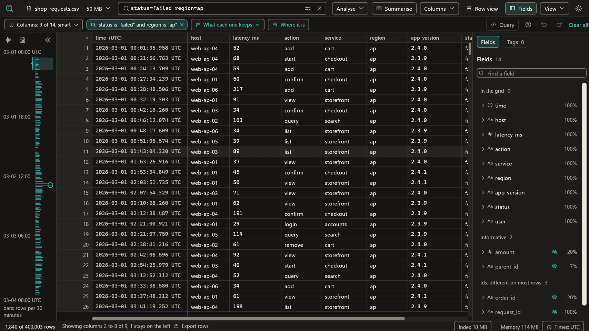
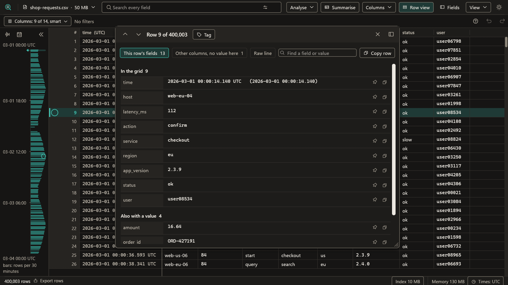
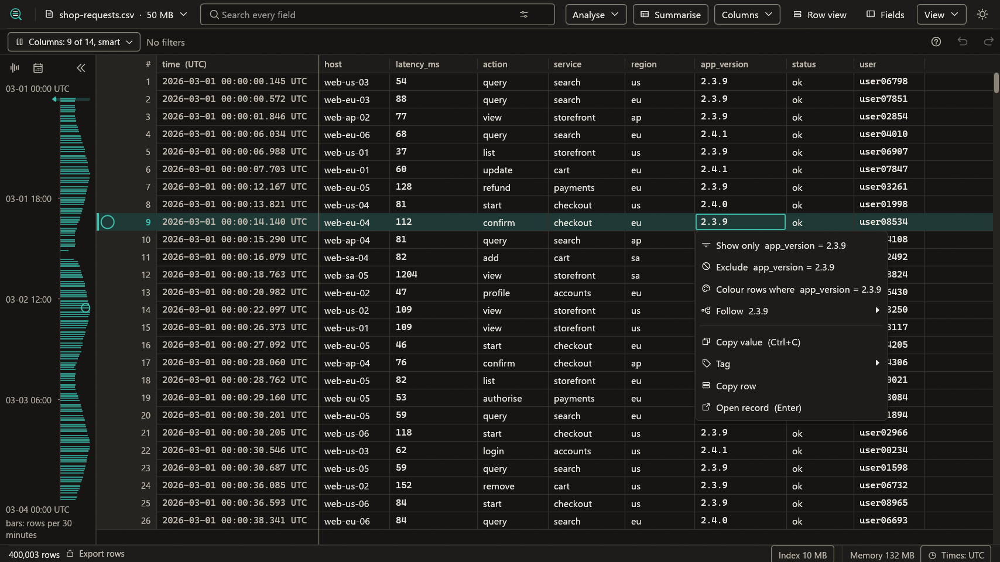
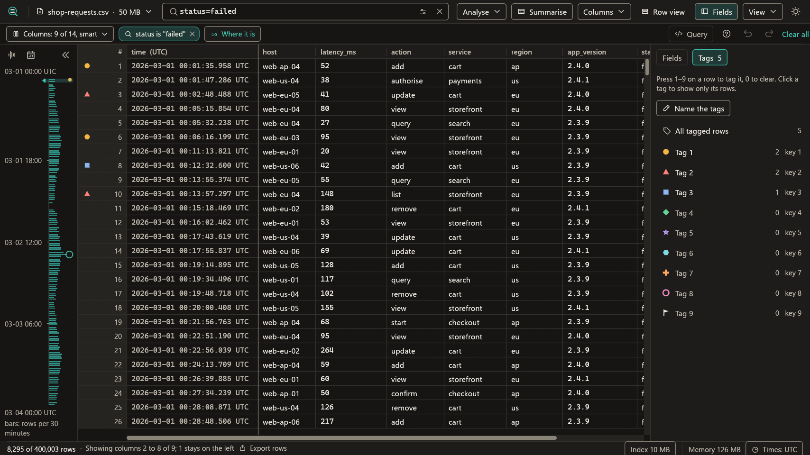
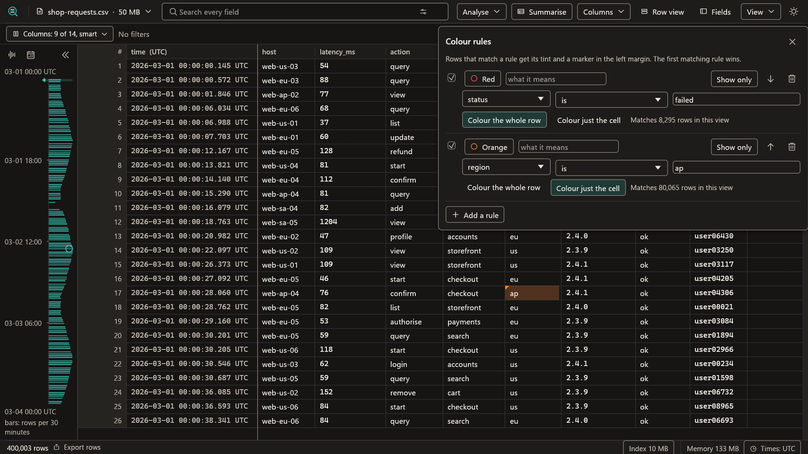
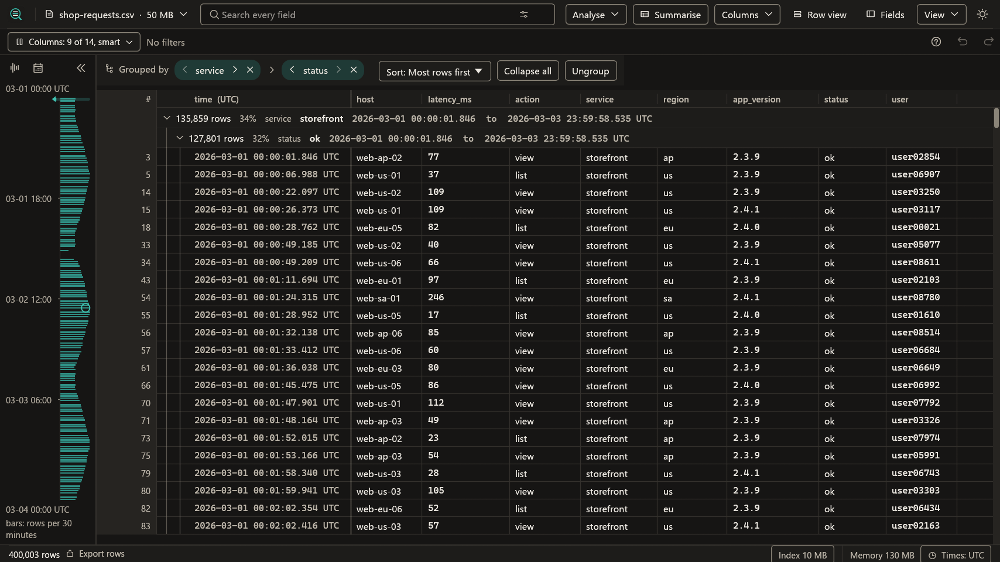

# The workspace

This page describes the screen you work in once a file is open: where each area is, how to move around the grid, how to select and copy rows, how to tag rows and colour them by rule, and how to control which columns you see and how they are ordered, pinned, wrapped, sorted and grouped. Searching and filtering have their own page: [Searching and filtering](searching-and-filtering.md).

## The screen areas

From top to bottom and left to right:

- **Top bar.** The file name and size (click it to open the case panel and switch file), then the search box, then the menus and buttons: **Analyse**, **Summarise**, **Columns**, **Row view**, **Fields** and **View**. A button at the right switches between the light and dark theme. `Ctrl+K` opens one list of every command and every column name.
- **Search box.** Hint text reads "Search every field". Press `/` to go to it.
- **Filter strip.** Every filter in force is a chip in plain words. See below.
- **Time spine.** A rail on the left of the rows that shows the file's time from top to bottom. See below.
- **Grid.** The rows and columns.
- **Fields drawer.** A panel on the right with two tabs, **Fields** and **Tags**.
- **Row view.** One row as a table, docked on the right or floating over the grid.
- **Status bar.** Rows matched of total, sort, selection, column position, **Export rows**, the time display, memory in use, and the index size.

### Filter strip

Every filter appears as a chip in words, for example "host is not web1". Right-click a chip to **Invert: keep the rows that do not match**, to **Switch off (keep it, filter nothing)**, or to **Remove** it. The strip also has **Clear all**, undo and redo arrows (`Ctrl+Z`, `Ctrl+Y`), a help button (`?`), and a **Query** button. **Query** shows the exact query the filters run. From there you can **Copy** it or choose **Edit as text** to move every filter into the search box. `Ctrl+Z` brings the chips back.

A filter that names a column the open file does not have is shown as "not applied: this file has no such column".

### Time spine

The spine is a rail beside the rows. Each bar is a stretch of time. Its length is how many rows it holds. The scale is written under the rail, for example "bars: rows per hour". A bracket shows where the rows on screen sit. A ring marks the busiest stretch. Tagged rows sit in a lane at the right edge of the rail, each in its tag's shape and colour.

To use the rail:

- Click it to bring the first row at or after that time to the top.
- Scroll the wheel over the rail to scroll the rows.
- Drag down the rail to keep a period.
- Double-click a stretch to keep it.
- Press `Esc` over the rail to step back out.
- From the keyboard, press `Tab` to reach the rail. `Up` and `Down` (and `Page Up`, `Page Down`, `Home`, `End`) move the rows stretch by stretch. `Enter` keeps the stretch.

A kept period shows as a band on the rail and as one chip, "Time from … to … UTC". It is not written into the search box.

When the rows are sorted by another column, a time is no place in them, so the rail keeps periods only and says why. If the file has no time column there is no spine and the rows take the width.

To fold the rail away, click the double arrow at its top, press `Ctrl+Shift+B`, or use the **View** menu ("Fold the time rail away"). A narrow strip stays with one button to bring it back. The choice is remembered. The rail's top also holds the buttons for **Timeline signals** and the **Calendar**. See [Searching and filtering](searching-and-filtering.md) and [Analysis](analysis.md).

### Fields drawer

Open it with the **Fields** button or `Ctrl+B`. Until you open or close it yourself, it opens by itself only where the window is wide enough (about 1,500 px). The **Fields** tab lists every column with how full it is, a show or hide control, and its most common (or rarest) values. Click a value to filter by it. **Find a field** narrows the list.

The list comes in sections, each headed with its count: **In the grid**, **Informative**, **Ids: different on most rows**, **Same on every row**, **Sparse: under 5% of rows**, **Empty**, and **Made by you**. Until the columns have been profiled it is one list with time first.

Open a field to see **Every value: N in all**, which opens the full value list for that column.

The **Tags** tab is described under Tags below.

### Row view

Open it with `Space`, `Enter`, a double-click on a row, or the **Row view** button. It shows every field of the selected row as a table. Tabs:

- **This row's fields** (the default). It reads **Pinned** first, then **In the grid**, then **Also with a value**. A structured cell (JSON, XML) has its own section.
- **Other columns, no value here.** The columns that other rows of the file have and this row does not hold, or holds blank. In a file where each line has its own fields (most JSON logs), a row holds only a few of the file's columns, so most columns are in this list for any one row. They are named, never hidden, and never shown as if the row had them.
- **Raw line.** The line as it is in the file.

Pin a field with the pin on a hovered row or its right-click menu. Pinned fields stay first on every row and are remembered. Right-click a value for **Show only**, **Exclude**, pin and copy. **Find a field** narrows every tab. The header has a **Tag** menu for the row and a button to dock or float the view. Copy the whole row from the **Copy row** menu: **As JSON**, **As text (name = value)**, **As CSV (names, then values)**, or **The line from the file**.

Words the search is looking for are marked in the values.

### Status bar

The status bar shows, among other things:

- "N of M rows" matched, or "M rows" when nothing is filtered.
- "N rows selected".
- "Sorted by X, largest first" with **Clear sort**.
- "Columns 3–8 of 8, 1 kept on the left". Click it, or press `Ctrl+G`, to go to a column.
- **Export rows**, which saves the rows the search keeps as CSV or JSON Lines. See [Export and sharing](export-and-sharing.md).
- The time display. Choose **As written in the file** or **All in UTC**. The timeline is always UTC.
- "Memory N MB": the memory LogSeek is using now. Hover for its limit.
- The index size. Click it for the folder where it is kept. See [Getting started](getting-started.md).

One-off messages, such as rows copied or an export result, appear just above the status line with **Dismiss**.

## The focused cell and moving around

The grid has a focused cell. Click a cell to focus it. These keys move you:

- `Up`, `Down`, `Page Up`, `Page Down` move through rows.
- `Left`, `Right`, `Home`, `End` move the focused cell across the columns.
- `Ctrl+Home`, `Ctrl+End` go to the first or last row.
- `Enter` opens the row view for the selected row.
- `Shift+F10` opens the menu of the focused cell. `Alt+Down` opens the menu of its column. `F` opens the values of its column to filter by.
- `Alt+Left` and `Alt+Right` fold or unfold a row in a tree of rows.

You can also use the mouse wheel, `Shift` plus the wheel to scroll sideways, and the scrollbars. Click the scrollbar track to jump, or drag the thumb. While you drag, a bubble reads "Row 12,040 of 22,615".

A band on the left holds the row numbers. Rows are counted as they are listed: 1, 2, 3 in the current sort and filters, so the number says how far down the list a row is. To see each row's own number in the file instead, open **View** and choose **Number rows as in the file**; that number stays the same after filters and sorting, so gaps show where rows were left out. Row view always says both. A tree of followed rows always shows file numbers.

The time column stays on the left while the other columns scroll under it. Any column can be kept there: see Pin below. For the full key list see [Keyboard](keyboard.md).

### Quiet gaps

Where the time between two rows on screen is far longer than usual, a thin band says how long it was quiet, for example "9 h 5 m 40 s quiet". It appears only when the rows run in time order. With a search or filter on, the band says "with no matching row" instead, because the log itself was not silent.

## Select and copy rows

- Click a row to select it.
- `Shift`+click selects a range. `Ctrl`+click adds or removes a row.
- `Shift+Up` and `Shift+Down` stretch the selection. `Ctrl+A` selects every row of the list.
- `Ctrl+C` copies the focused cell, or the selected rows when there are several. Rows are copied tab-separated, in the column order on screen.
- `Ctrl+Shift+C` copies the selected rows with the column names first.

Right-click a selection for **Copy the N selected rows** and **Copy them with the column names**. Right-click a column name for **Copy this column**, which copies every value of the rows shown. Every copy says what it copied.

Selecting rows works in the plain list. It does not work in the grouped view or in a tree of followed rows. A very large copy is refused with a pointer to **Export rows**.

## Cell menu

Right-click a cell. The menu offers **Show only** (the column equals this value), **Exclude**, **Colour rows where** (column = value), **Copy value**, **Tag**, **Copy row**, and **Open record**. Show only and Exclude become a chip in the filter strip. They are never added to the search box.

Right-click inside a grouped row does not act yet.

## Tags

Tags mark rows. There are nine, with keys `1` to `9`. Each has its own shape and colour. `0` clears the row's tags. You can also use the **Tag** menu on the cell menu or in the row view.

Tags carry no meaning of their own. They are "Tag 1" to "Tag 9" until you name them. Open the **Tags** tab in the drawer and choose **Name the tags**. Names are kept for every file. An emptied name goes back to its number. The Tags tab also shows each tag's row count. Click a tag there to show only rows with that tag. **Show all rows** brings them back.

Tags are saved next to the file's index. They show as marks on the row band, and on the time spine.

To give the tags your own names, press **Name the tags** at the top of the Tags tab: each tag's row becomes a box to type its name in, beside its mark, count and key. Press **Done naming** when finished. An empty name goes back to the tag's number; names are kept for every file.

## Colour rules

Colour rules tint rows or cells that match. Open **View**, then **Colour rules**. Nothing is built in. Every rule is yours. The first matching rule wins.

To make a rule from what you see, right-click a cell and choose **Colour rows where** column = value. It takes a tint no rule uses yet and opens the sheet so you can change it.

Each rule has a name ("what it means"), a column or "any column", a condition, and a value. Choose **Colour the whole row** (tint and a mark in the margin) or **Colour just the cell** (tint and a mark in the cell's corner). A line under the rule says how many rows of the current view it matches, for example "Matches 12 rows in this view". **Show only** filters the grid to the rows a rule matches. Use the arrows to reorder rules; a rule higher up is checked first. **Add a rule** adds one. The colour's name is written beside its swatch, so colour is never the only cue.

## Columns

### Smart view and every column

A file with more than 12 columns opens in the smart view. It shows the time column and the most telling columns, judged from their own values. A pill above the grid says so, for example "Columns: 9 of 673, smart". Use the **Columns** menu to switch:

- **Smart: the most telling columns**
- **Every column, in file order**
- **Choose columns**

Columns that hold one value on nearly every row are named once in a "Same on every row" line, each with its value. The line says the threshold: at least 95% of rows. **Show as a column** brings one into the grid.

### Columns view

Press `Ctrl+2`, or choose **Columns view: every column at a glance** from the **Columns** menu. It replaces the grid with a table of every column, one per line. Each line has a tick to show or hide the column, its name (click to go to it in the rows), its type, how full it is, what kind of column it is, and its most common values. Pills above the list show **All**, **Shown**, or a single kind, each counted. **Find a column** narrows by words in any order. Press `Ctrl+1`, or choose **Back to rows**, to return.

### Choose columns

Press `Ctrl+G` or choose **Choose columns**. The sheet has two lists: **Shown, in this order** and **Add a column**. In the first, drag a row by its handle, use the arrows to move it, **x** to hide it, or the pin to keep it on the left. **Show none** starts from nothing. **Show all**, **Hide empty** and **Reset order** do what they say. In the second, search for a column and press `Enter` or click to add it after the last column shown.

### Pin, wrap, fit and sort

Right-click a column name for its menu. It includes:

- **Values and filter**
- **Show values as**: how this column's values read on screen. A column of numbers can be read as times: seconds, milliseconds, microseconds or nanoseconds since 1970, Windows FILETIME, WebKit / Chrome time, Apple Cocoa time, or a spreadsheet day number. Each choice shows what it makes of a value from the rows on screen, so you can see which one is right before you pick it. A column LogSeek already reads as a time can be shown **As written in the file** instead. The column name gains "(UTC)" while its values are shown as times. Only the display changes: the file, searches and sorting still use the values as written, and the choice is remembered for that file.
- **Add a column from this one**
- **Fit width to content**. You can also double-click the column's right border. **Fit all columns to content** fits every column. Drag a column's edge to resize it.
- **Keep on the left** or **Let it scroll**. A kept column stays beside the row numbers while you scroll sideways.
- **Wrap long text** or **Show on one line**. Wrapped rows grow to show the whole value.
- **Sort smallest first (A to Z, oldest)**, **Sort largest first (Z to A, newest)**, and **Clear the sort**.
- **Group rows by this column**
- **Choose columns**
- **Move left**, **Move right**, **Hide column**, **Copy column name**, **Copy this column**
- **Convert**, **Rename this column**, **Remove this column** (made columns)
- **Shapes in this column**, **Strange text in this column**, **Patterns in this column**, **Rare pairs with this column**. See [Analysis](analysis.md).

Drag a column name to move it. A click on a column name sorts: smallest first, again for largest first, a third time to clear. Numbers and times sort by value, text ignores capitals, and empty values go last. The status bar shows the sort.

From the keyboard, `Alt+Down` opens this menu for the focused cell's column.

### Group

Choose **Group rows by this column**, or drag a column name onto the place that appears above the grid ("Drop here to group the rows by …"). A **Grouped by** line shows one chip per level. Use the arrows on a chip to reorder it, and the cross to remove it. You can also drag chips. **Sort** offers **Most rows first**, **Fewest rows first (rare)**, **First seen first**, **Last seen first** and **By name, A to Z**. **Collapse all** and **Ungroup** are beside it.

Each group header shows its rows, their share of all rows, and the first and last time. Click or press `Right` to open a group, and `Left` to close it or go to its parent. An open group scrolls through all its rows. The grouping is kept with the tab.

Grouping by a column you made is not available yet. Add a column to make one: see [Columns and formulas](columns-and-formulas.md).

## Tabs and look

When more than one file is open, each has a tab under the top bar. A tab is named by what tells its file from the others: files unpacked from one archive, or exported with one long shared prefix, show only the part that differs, and the whole name is on the tab's hover and in the window title. The tabs take up to two lines and scroll beyond that, so they never take the rows' room, and the tab you go to is brought into view. The **tabs** button at the start of the strip lists every open file by its whole name, with a box to find one by part of its name; that is the way to one file among a hundred. The file name in the top bar never takes more than two fifths of the bar, so the search box keeps its place.

`Ctrl+T` adds another view of the same file with its own search, filters, sort and hidden columns. `Ctrl+W` closes a tab and `Ctrl+Tab` goes to the next. Zoom with `Ctrl` plus or minus, `Ctrl+0`, or `Ctrl` and the mouse wheel. The **View** menu switches **Compact rows** and **Comfortable rows**, and shows or hides grid lines.

## Staying on your row

When the rows change (a filter is removed, **Show all rows**, a sort), the row you had selected stays selected and is brought into view a third of the way down, so the rows that came before and after it are on screen. If the row is not in the new result, the list starts from the top.

## Analysis sheets

Patterns, Shapes, Strange text, Rare pairs, Timeline signals, What sets these rows apart and Search a list all open in the same place at the same size, under the top bar, and stay there while you page through them. **Show these rows** puts the sheet aside so the rows can be seen. **Back to …** in the status bar brings the last sheet back exactly as you left it: its column, its choices and its page.

## Closing the app

Closing the window asks **Close LogSeek Studio?** first, so a slip of the mouse does not end a long look through a file. **Close** (or `Enter`) closes; **Stay** (or `Esc`) keeps the window. Your search, filters, tags and the columns you made are kept either way. Tick **Do not ask again** to close at once from then on.
